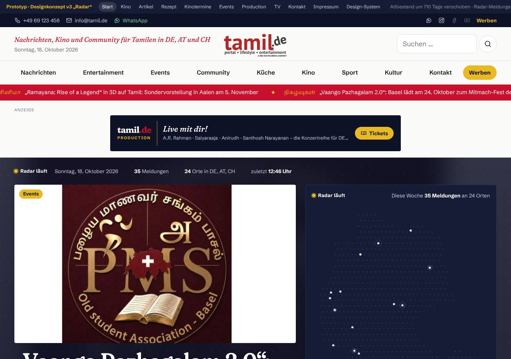
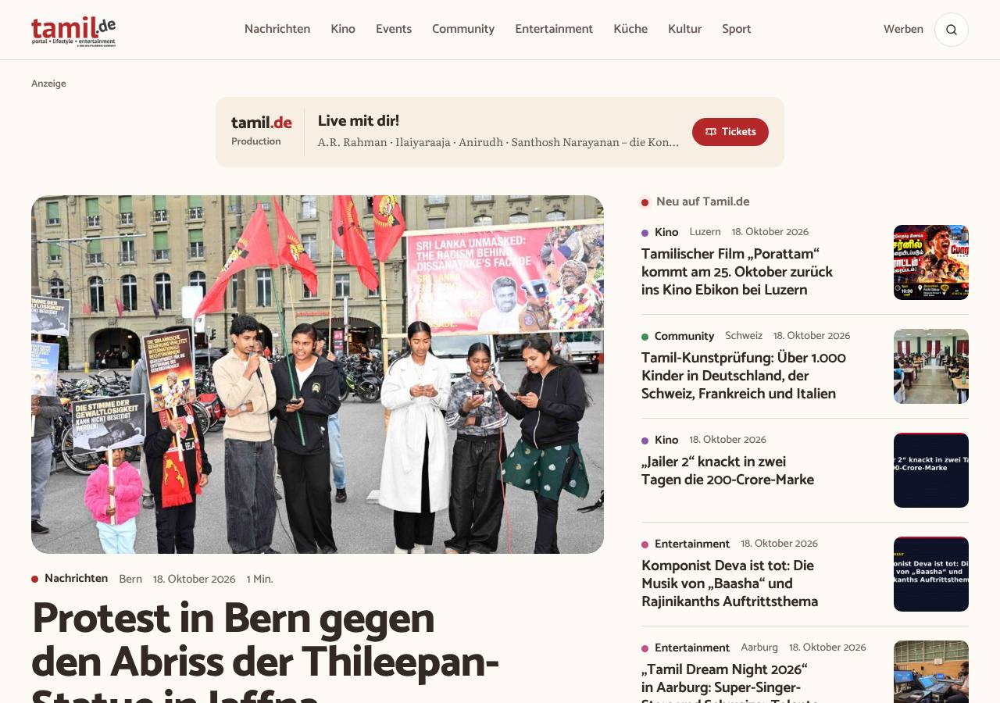
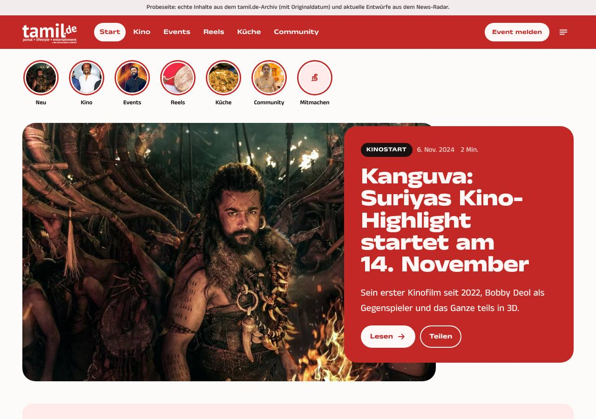

# Abgelehnte Entwürfe

Drei Runden, drei Ablehnungen. Jede Runde hat etwas anderes falsch gemacht; die gemeinsame Ursache war der Ablauf
(allein entworfen, keine Referenzen des Auftraggebers, keine unabhängige Kritik, sofort ganze Seiten). Bilder: erster
Bildschirm Desktop (1280) und Handy (390) im Ordner `abgelehnt/`.

## Runde 1 – „Radar“, Prototyp v3 (Oktober 2026)

- **Was es war:** Nachtblau/Indigo als Bühne, Gold-Gelb als Akzent, Rot-Laufband mit tamilischen Wörtern als
  Rubrikmarke, Fraunces/Schibsted Grotesk/Noto Serif Tamil, dunkle Werbeflächen, „Radar läuft“-Karte.
- **Urteil:** „Katastrophe“.
- **Warum:** zu viele Farben gleichzeitig (Nachtblau, Rot, Gelb, Gold, Grün), dunkle Bühne wirkt wie Gaming,
  tamilische Wörter als Deko, Werbung dominiert, technische Radar-Spielerei auf der Leserseite.

## Runde 2 – „Modernes Community-Magazin“, WordPress-Theme (20.10.2026)

- **Was es war:** warmes Weiß/Sand, dunkles Braungrau, Rot sparsam, Catamaran + Literata (Serife im Fließtext),
  große abgerundete Bilder, farbige Rubrikpunkte, Mosaik-Startseite, rotes Mitmach-Band.
- **Urteil:** „altbacken“, „hingerotztes News-Magazin“, „voll das alte Design“.
- **Warum:** ordentlich, aber ohne Idee; sieht aus wie jedes Nachrichtenportal; Serife und Creme lesen sich alt;
  nichts daran spricht Gen Z an.

## Runde 3 – „Gen-Z-Probeseite“ (`prototyp/genz/`, 09.11.2026)

- **Was es war:** roter Kopf, Instagram-Story-Kreise, rote Platte mit breiter fetter Grotesk (Anek Tamil) über dem
  Aufmacherbild, Pillen-Labels, runde Karten, rosa „In 30 Sekunden“-Kasten mit 01/02/03, Poster-Leiste, Tickets,
  Reels-Kacheln, rotes Band mit Kolam-Linien.
- **Urteil:** „das Design ist Trash, komplett generisch“ – aber „da ist auf jeden Fall viel Potenzial und Luft nach
  oben“.
- **Warum:** sieht aus wie eine App-Vorlage (Pillen, Rundungen, Kreise, Knopfreihen); jedes Element ist ein bekanntes
  Muster; keine eigene Idee, kein Vorbild; Gen Z wurde als „Social-Bausteine einbauen“ missverstanden statt als
  eigene Haltung. Brauchbar bleiben: Rot als Hauptfarbe, große Bilder, Kino/Events als Stärke, Teilen über WhatsApp.

## Was daraus folgt

1. Jede neue Richtung braucht ein **benanntes echtes Vorbild** und eine **Idee**, die nur zu tamil.de passt.
2. Gestaltung wird **von einem unabhängigen Kritiker** geprüft, bevor der Auftraggeber sie sieht (≥ 28/40, Slop-Test).
3. Erst **Skizzen vergleichen** (Tor G2), dann ganze Seiten.
