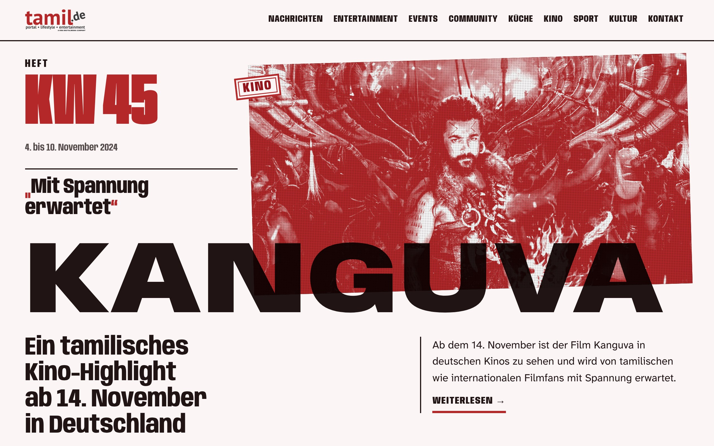
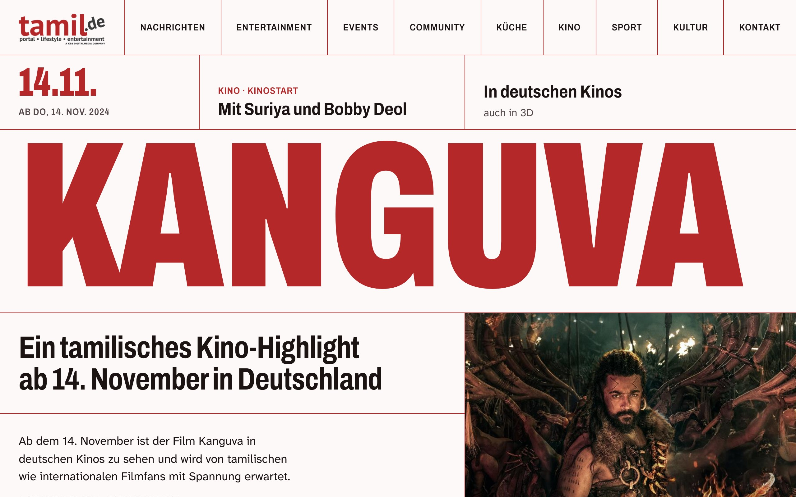
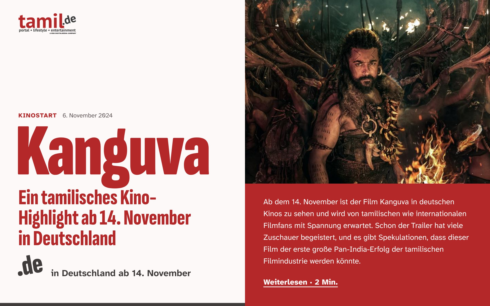

# Abgelehnte Entwürfe

Vier Runden, vier Ablehnungen. Zwei fielen durch, weil sie alt oder generisch wirkten (Runde 2, Runde 3), zwei, weil
sie laut waren oder wie ein Baukasten aussahen (Runde 1, Runde 4). Wer die eine Seite vermeidet, darf nicht in die
andere kippen. Bilder: erster Bildschirm Desktop (1280) und Handy (390) im Ordner `abgelehnt/`.

## Runde 1 – „Radar“, Prototyp v3 (Oktober 2026)

- **Was es war:** Nachtblau/Indigo als Bühne, Gold-Gelb als Akzent, Rot-Laufband mit tamilischen Wörtern als
  Rubrikmarke, Fraunces/Schibsted Grotesk/Noto Serif Tamil, dunkle Werbeflächen, „Radar läuft“-Karte.
- **Urteil:** „Katastrophe“.
- **Warum:** zu viele Farben gleichzeitig (Nachtblau, Rot, Gelb, Gold, Grün), dunkle Bühne wirkt wie Gaming,
  tamilische Wörter als Deko, Werbung dominiert, technische Radar-Spielerei auf der Leserseite.

## Runde 2 – „Modernes Community-Magazin“, WordPress-Theme (20.10.2026)

- **Was es war:** warmes Weiß/Sand, dunkles Braungrau, Rot sparsam, Catamaran + Literata (Serife im Fließtext),
  große abgerundete Bilder, farbige Rubrikpunkte, Mosaik-Startseite, rotes Mitmach-Band.
- **Urteil:** „altbacken“, „hingerotztes News-Magazin“, „voll das alte Design“.
- **Warum:** ordentlich, aber ohne Idee; sieht aus wie jedes Nachrichtenportal; Serife und Creme lesen sich alt;
  nichts daran spricht Gen Z an.

## Runde 3 – „Gen-Z-Probeseite“ (`prototyp/genz/`, 09.11.2026)

- **Was es war:** roter Kopf, Instagram-Story-Kreise, rote Platte mit breiter fetter Grotesk (Anek Tamil) über dem
  Aufmacherbild, Pillen-Labels, runde Karten, rosa „In 30 Sekunden“-Kasten mit 01/02/03, Poster-Leiste, Tickets,
  Reels-Kacheln, rotes Band mit Kolam-Linien.
- **Urteil:** „das Design ist Trash, komplett generisch“ – aber „da ist auf jeden Fall viel Potenzial und Luft nach
  oben“.
- **Warum:** sieht aus wie eine App-Vorlage (Pillen, Rundungen, Kreise, Knopfreihen); jedes Element ist ein bekanntes
  Muster; keine eigene Idee, kein Vorbild; Gen Z wurde als „Social-Bausteine einbauen“ missverstanden statt als
  eigene Haltung. Brauchbar bleiben: Rot als Hauptfarbe, große Bilder, Kino/Events als Stärke, Teilen über WhatsApp.

## Runde 4 – vier Richtungsskizzen „Plakatwand, Zine, Raster, Feed“ (`design/richtungen/`, 09.11.2026)

- **Was es war:** vier Skizzen nach dem ersten Brief („eine Geschichte als Cover“, „Rot trägt die Seite“, „laut im
  Kopf“). Ein riesiges rotes Titelwort („KANGUVA“) über die volle Breite; schmal oder breit verzerrte
  Auszeichnungsschriften (Sofia Sans Extra Condensed, Anybody, Archivo, Bricolage Grotesque); je ein
  „Signatur-Element“ (Heftkopf mit Stempel und rot gedrucktem Halbtonfoto, rotes Linienraster mit Fahrplanzeile,
  schiefes „.de“ als Länderzeichen, rote Plakatwand); feste Daumenleiste; im ersten Bildschirm nur eine Geschichte.
- **Urteil (Luis, 09.11.2026, vor der Vorlage beim Auftraggeber):** „Richtung sieht scheiße aus.“ Auf Nachfrage alle
  vier Punkte: „zu viel Rot, zu laut“, „sieht nach Baukasten aus“, „Schrift ist hässlich“, „nicht hochwertig
  genug“. Gewünscht stattdessen: „wie eine große News-Marke“.
- **Warum:** Die Idee stand vor Lesbarkeit und Wertigkeit. Alle vier sahen aus wie Geschwister: rote Riesenschrift auf
  hellem Grund über demselben Foto. Drei bestanden die unabhängige Kritik mit genau 28/40, obwohl der Bogen nie nach
  „hochwertig“ fragte und die Kritiker die Schwelle kannten. Die Vorbilder kamen nur aus Kunst, Zine und Streetwear,
  keines aus der Nachrichtenwelt.
- **Brauchbar bleibt:** der ruhige, gut lesbare Artikel; Kino und Termine als nüchterne Liste mit Ort und Datum;
  Teilen über WhatsApp als schlichter Link.

## Was daraus folgt

1. Ziel ist eine **große, ruhige Nachrichtenmarke** (Vorbilder mit Messwerten: `design/referenzen/news-marken.md`).
   Vertrautheit ist erwünscht, Eigenwilligkeit ist kein Ziel.
2. „Wertig“ wird **gemessen** (harte Kriterien in `design/brief.md`), nicht bepunktet. Eine Punktsumme ist kein Tor.
3. **Luis sieht Schnellproben früh und ungefiltert.** Der Auftraggeber sieht nur, was Luis gewählt hat und was die
   unabhängige Prüfung bestanden hat.
4. **Nicht in Runde 2 zurückfallen:** kein Creme oder Sand, keine braungraue Tinte, keine Serife im Fließtext, keine
   runden Bilder, keine bunten Rubrikpunkte, kein Mosaik, keine Werbung über dem Aufmacher.
