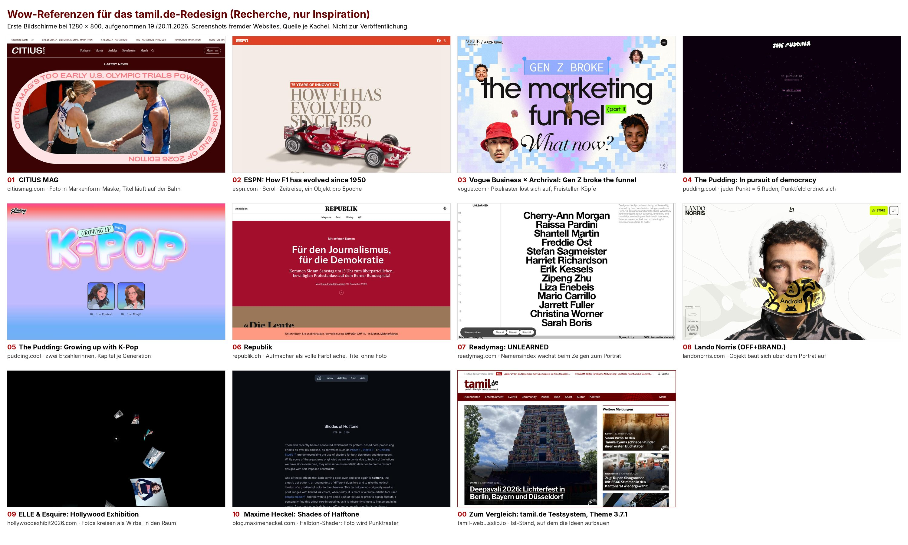

# Wow-Referenzen für das Redesign (November 2026)

> **Nur Recherche und Inspiration.** Nichts davon ist entschieden, freigegeben oder gebaut. Am Theme wurde nichts
> geändert. Die Screenshots in `shots/` und `uebersicht.jpg` zeigen **fremde Websites** (Quelle je Eintrag). Sie sind
> Arbeitsmaterial für Luis und **nicht zur Veröffentlichung** bestimmt.

Luis wünscht sich einen echten Wow-Effekt: „die beste News-Seite, die es jemals gegeben hat“. Hier stehen zehn aktuelle
Websites (2025–2026), deren Wirkung sich auf tamil.de übertragen ließe. Dazu kommen sieben Ideen, die diese Mechanismen
mit dem Punktbogen „Tamil Dots 04A“ verbinden.

Feste Grundlage, die keine Idee antastet (`docs/branding/2026-11-19-branding-master-v1.1.md`):

- Weiß `#FFFFFF` als Grundfläche, Titan `#660000` dominant, Impact `#B30000` als Akzent, Schwarz `#000000` für Text.
- Tamil Dots 04A ist ein Motiv und kein Logo. Die Form bleibt unverändert: großer Fuß links, feiner Auslauf rechts,
  freie Fläche unter dem Bogen.
- Das Logo bleibt, wie es ist.

## Was es schon gibt (Theme 3.7.1, Testsystem, angesehen am 20.11.2026)

Diese Punkte sind gebaut und werden unten **nicht** als neu vorgeschlagen (`shots/00-tamil-de-testsystem-3.7.1-*`,
`DESIGN.md` auf `claude/radar-multiagent`):

- Neues Logo von Luis.
- Jede Meldung ist eine Bildkarte mit Titel im Bild, weiß auf dunklem Verlauf.
- Ein kleiner Punktbogen sitzt unten rechts in jedem Beitragsbild.
- Das Signet liegt als Hintergrund auf den Titan-Flächen („Diese Woche“, Termine), im Rubrikband, in Seitenköpfen und im Fuß.
- Auf Titan-Flächen bauen sich die Punkte vom Fuß zum Auslauf auf („Punkte bauen die Form auf“).
- Die 03-Spatial-Fassung steht auf der 404-Seite und bei Production.
- Bewegung D:
  - Der Kopf schrumpft, eine Leselinie wächst mit.
  - Das Aufmacherbild läuft langsamer als die Seite.
  - Die Titan-Fläche zieht als Vorhang auf, große Bilder decken sich von unten auf.
  - Kacheln erscheinen gestaffelt.
  - Der erste Bildschirm bewegt sich nie von selbst.

## So wurde gesucht

- **Quellen:**
  - Awwwards, Kategorie „Magazine / Newspaper / Blog“, Seiten 1–4, mit Site of the Day und Honorable Mentions 2025–2026.
  - Die Startseite von The Pudding.
  - Bekannte Nachrichten-, Kultur- und Markenseiten aus Vorwissen. Jede Seite wurde selbst geöffnet.
  - Highsnobiety, Hypebeast, Dazed, i-D und Brut stehen bereits in `../README.md` (09.11.2026). Sie zeigen dort keinen
    eigenen Wow-Mechanismus und sind hier nicht wiederholt.
- **Screenshots:**
  - Playwright/Chromium, 1280 × 800: erster Bildschirm (`-1280-oben`) und eine gescrollte Stelle (`-1280-scroll`).
  - 390 × 844: erster Bildschirm (`-390-oben`, zweifache Pixeldichte). JPEG mit Qualität 75.
  - Cookie-Hinweise blieben unberührt, so wie sie erscheinen. Nichts wurde akzeptiert, kein Login, keine Paywall umgangen.
- **Gesehen:** alle Referenzen am 19.11.2026, das Testsystem am 20.11.2026.
- **Auszeichnungen:**
  - Angaben aus den Awwwards-Listen vom 19.11.2026.
  - Bei Lando Norris zusätzlich aus dem Awwwards-Profil von OFF+BRAND.
- **Aufwand** grob und ohne Gewähr:
  - **S:** bis 2 Tage.
  - **M:** 3–10 Tage.
  - **L:** mehr als 2 Wochen, oft wegen Redaktion und Bildmaterial.
- **Verbotsliste:** `.claude/skills/tamil-marke/references/abgelehnt.md`, Runden R1 bis R7.

## Die zehn Referenzen

| Nr | Referenz | Was den Wow macht | Idee für tamil.de mit 04A | Aufwand | Risiken |
|---|---|---|---|---|---|
| 01 | **CITIUS MAG**: Laufsport-Magazin (USA). [citiusmag.com](https://citiusmag.com/). Awwwards Honorable Mention 16.01.2025 (Butter Studio) | Dunkelrote Grundfläche, fast Titan. Das Aufmacherfoto ist in die Form einer Laufbahn geschnitten, die Schlagzeile läuft als Schrift rund um die Bahn. Die Marke steckt in der Bildform selbst. | Serien-Cover (z. B. „Deepavali 2026“) auf Titan. Das Foto liegt in der Kuppel-Silhouette von 04A, der kurze Serientitel läuft auf der Außenkante des Bogens. Die Schlagzeile steht gerade darunter. | S–M | Schrift auf einer Kurve liest sich schlecht, darum nur 2–4 Wörter. Runde Bildform (R2 „keine runden Bilder“, R3 „Rundungen“). Ein Foto unter dem Bogen widerspricht der Regel „freie Fläche bleibt frei“. |
| 02 | **ESPN: How F1 has evolved since 1950**. [espn.com/…/story?id=43832710](https://www.espn.com/espn/feature/story?id=43832710). Awwwards Honorable Mention 01.06.2026 | Je Epoche fährt ein freigestelltes Auto beim Scrollen über die leere Seite, Jahreszahl und Text wechseln mit. Große Antiqua-Titel, rot-weiße Randsteine gliedern. | Spezial „Zeitreise“: ein Gegenstand je Jahrzehnt der tamilischen Diaspora in DACH (Pass, Kassette, VHS, Kinokarte, Handy). Der 04A-Bogen dient als Zeitleiste: Punkte färben sich beim Scrollen von Impact zu Titan, der Fuß links ist der Anfang. | L | Lange Seite, große Freisteller kosten Ladezeit. Für ältere Leser braucht es „Als Text lesen“. Die beige Grundfläche nicht übernehmen (R2 Creme). |
| 03 | **Vogue Business × Archrival: Gen Z broke the marketing funnel (Part II)**. [vogue.com/…/gen-z-broke-the-marketing-funnel-part-ii-what-now](https://www.vogue.com/article/gen-z-broke-the-marketing-funnel-part-ii-what-now). Awwwards Site of the Day 04.01.2026 (Noomo Agency) | Freisteller-Köpfe junger Menschen schweben um den Titel aus Grotesk und Schreibschrift. Darunter liegt ein Pixelraster, das sich auflöst. Beim Scrollen wechselt die Kleidung an einer Figur. | Statt Pixeln ein Raster aus 04A-Punkten, das sich beim Scrollen zum Foto auflöst (Idee 1). Freisteller von Menschen aus der Community für Jugendthemen. | M | Beim ersten Aufruf zeigte die Seite nach mehreren Sekunden noch die Ladeanzeige. Der Schreibschrift-Mix wäre „verspielte Kursive“ und Schriftthema aus R4. Pastell passt nicht zur Marke. |
| 04 | **The Pudding: In pursuit of democracy** (Alvin Chang, November 2025). [pudding.cool/2025/11/democracy](https://pudding.cool/2025/11/democracy/) | Der erste Bildschirm ist ein Sternenfeld aus Punkten. Jeder Punkt steht für fünf Reden im US-Kongress, die „democracy“ erwähnen. Beim Scrollen ordnen sich die Punkte auf einer Zeitleiste, leuchtende Punkte markieren die Warnungen. Ein Klick öffnet die Rede. | „2026 in 238 Punkten“: Jeder der 238 Punkte des Masters wird eine echte Meldung des Jahres. Tippen öffnet sie, die Form bleibt exakt (Idee 2). | M–L | Punkte sind am Handy kleiner als 44 px, es braucht eine Listenansicht. Die dunkle Bühne nicht übernehmen (R1). Eine Datenspielerei wäre R1 („Radar-Spielerei“). |
| 05 | **The Pudding: Growing up with K-Pop**. [pudding.cool/2026/05/kpop-generations](https://pudding.cool/2026/05/kpop-generations/). Mai 2026 laut Startseite. Minji Kim und Eunice Lee mit Caitlyn Ralph, Illustration Damien Jeon, Design Jeff Kardos, Code Michelle Pera-McGhee | Zwei Erzählerinnen wechseln sich ab, fünf Kapitel folgen den K-Pop-Generationen. Dazwischen stehen Diagramme, eine Karte mit Punkten und das Quiz „Welche Generation bist du?“. | Format „Zwei Generationen“: Eltern, die nach 1983 kamen, und ihre Kinder erzählen über Kollywood, Feste und Sprache. Die Kapitelnavigation sind Punkte im Bogen (Idee 6). | M, vor allem Redaktion | Holo-Schrift, Pastell und Avatare in Rahmen sehen nach App aus (R3). Interviews und Fotos brauchen Einwilligungen. |
| 06 | **Republik**: Schweizer Magazin, Startseite. [republik.ch](https://www.republik.ch/) | Jede Geschichte ist eine eigene Farbfläche über die volle Breite. Der Aufmacher hat kein Foto, nur einen Titel auf Bordeaux. | Für die eine große Nachricht ohne gutes Foto: Titan-Fläche über die volle Breite, großer weißer Titel, der Bogen baut sich auf. **Ist großteils Bestand** (Titan-Flächen und Aufbau gibt es in 3.7.1), also nur ein Ausbau. | S | Serife im Fließtext (R2) nicht übernehmen. Mehr als eine solche Fläche je Bildschirm ist zu viel Rot (R4). |
| 07 | **Readymag: UNLEARNED**. [readymag.com/unlearned](https://readymag.com/unlearned). Awwwards Honorable Mention 25.03.2026 | 13 Namen von Gestalterinnen und Gestaltern als riesige gestapelte Liste. Der Name unter dem Zeiger wächst über die Spalte, daneben erscheinen Porträt und Kurztext. Am Handy steht eine nummerierte Liste mit Porträt. | „Köpfe 2026“: Menschen aus den Meldungen als Namensliste. Beim Scrollen wächst ein Name, ein Freisteller erscheint, der 04A-Bogen rahmt rechts angeschnitten (Idee 3). | M | Riesige Schrift streift R4. Hover gibt es am Handy nicht, also Scroll-Fokus. Für Freisteller braucht es Bildrechte. |
| 08 | **Lando Norris** (OFF+BRAND.). [landonorris.com](https://landonorris.com/). Awwwards Site of the Day 17.11.2025, laut OFF+BRAND-Profil Site of the Year 2025 | Beim Laden setzt sich ein 3D-Helm Stück für Stück über das Porträt. Danach folgt Satz in großer Versal-Grotesk, einzelne Wörter stehen in der Kontrastfarbe. | Porträt-Aufmacher für Interviews: Freisteller, hinter dem sich der 04A-Bogen Punkt für Punkt aufbaut. Das ist die bestehende Aufbau-Animation, hier hinter einem Menschen (Teil von Idee 3). | M ohne 3D | 3D/WebGL ist schwer und langsam. Versal-Satz fällt unter das Verbot der Versal-Labels (R5–7, für klar2 nicht aufgehoben). Der Bogen darf das Gesicht nie überlagern. |
| 09 | **ELLE & Esquire: The New Hollywood Photography Exhibition** (Hearst, OSMOS). [hollywoodexhibit2026.com](https://www.hollywoodexhibit2026.com/). Awwwards Site of the Day 02.08.2026 | Titelbilder und Fotos kreisen als Wirbel in einen schwarzen Raum. Danach landen sie als Auswahl zweier Galerien. | „Bogen-Galerie“ für Fest- und Eventfotos: Die Fotos fliegen auf der Bahn des 04A-Bogens ein, groß links, klein rechts, und setzen sich zu einer ruhigen Bildreihe (Idee 7). | M–L | WebGL ist auf schwachen Handys langsam. Dunkle Bühne (R1). Die Bewegung kann schwindlig machen; ohne Bewegung wird es eine einfache Reihe. |
| 10 | **Maxime Heckel: Shades of Halftone**. [blog.maximeheckel.com/posts/shades-of-halftone](https://blog.maximeheckel.com/posts/shades-of-halftone/). Datiert 18.02.2026. Technik-Referenz, kein Magazin | Interaktive Shader-Demos zeigen, wie ein Bild zum Punktraster wird. Regler stellen Punkt- und Rastergröße ein, die Punkte wachsen mit der Helligkeit (Screenshot `-1280-scroll`). | Technische Grundlage für Idee 1: Ein Foto entsteht aus den Punkten von 04A. | Umsetzung M | GPU-Last, darum nur 1–3 Bilder je Seite. Statisches Foto als Ersatz. Ein dauerhaft rotes Halbtonfoto war Teil von R4. |

## Wow-Ideen für tamil.de

Die Rangfolge richtet sich nach drei Fragen:

- Wie stark ist der erste Eindruck?
- Wie sehr gehört die Idee nur zu tamil.de?
- Wie gut verträgt sie sich mit Lesbarkeit, Tempo und Verbotsliste?

Für alle Ideen gelten dieselben Pflichten:

- Bewegung nur unter `prefers-reduced-motion: no-preference`.
- Der erste Bildschirm bewegt sich nie von selbst.
- Ohne Bewegung und ohne Skript bleibt ein fertiges, ruhiges Bild.
- WCAG 2.2 AA, Tippflächen ab 44 px, Fließtext ab 18 px am Handy.
- Die Punkte liegen nie über Titeln. Über Gesichtern liegen sie höchstens kurz während eines Übergangs.

**Einordnung gegen die Verbotsliste.** Die Liste verlangt eine „große, ruhige Nachrichtenmarke“ und sagt:
„Eigenwilligkeit ist kein Ziel“. Der Wunsch nach Wow steht dazu in Spannung. Darum setzen die Ideen den Wow an
**wenigen besonderen Orten** ein: Aufmacher-Übergang, Spezialseiten, Jahresrückblick, Porträts. Die Nachrichtenfläche
bleibt klar2.

### 1. „Punkt für Punkt zum Bild“: das Foto entsteht aus dem Bogen

- **Was der Leser sieht:**
  - Ein großes Bild unterhalb des ersten Bildschirms zeigt zunächst nur die 04A-Kuppel. Das ist z. B. das Bild von
    „Diese Woche“, der Aufmacher eines Spezials oder das Bild im Artikel.
  - Durch jede der 238 elliptischen Punkte sieht man ein Stück des Fotos.
  - Beim Scrollen wachsen die Punkte vom großen Fuß links zum feinen Auslauf rechts, bis sie verschmelzen und das ganze
    Foto in Farbe steht.
  - Danach kommt der Titel.
  - Statisch, etwa für Social oder Print, bleibt die Fassung „Foto durch die Punkte“ als Cover-Motiv.
- **Warum nur tamil.de:** Das Markenzeichen ist das Fenster zum Bild. Die Form bleibt exakt, die Punktlagen kommen aus
  `design/signature/daten/punkte.json`. Die bestehende Animation „Punkte bauen die Form auf“ wächst nur weiter, bis aus
  der Form das Foto wird. Keine andere Nachrichtenseite kann das zeigen.
- **Neu gegenüber 3.7.1:** Heute decken sich große Bilder von unten auf. Hier entsteht das Bild aus dem Signet.
- **Wo:** Höchstens 1–3 Bilder je Seite: „Diese Woche“, Spezial-Aufmacher, Artikel-Aufmacher. Nicht auf jeder Karte.
- **Referenzen:** [Shades of Halftone](https://blog.maximeheckel.com/posts/shades-of-halftone/) (Technik) und
  [Vogue Business × Archrival](https://www.vogue.com/article/gen-z-broke-the-marketing-funnel-part-ii-what-now) (Raster
  löst sich auf).
- **Aufwand:** M. SVG-Maske aus den 238 Ellipsen mit `scale` am Scrollweg reicht ohne WebGL.
- **Lesbarkeit:** Der Titel erscheint erst, wenn das Foto steht. Er liegt nie im Raster.
- **Tempo:**
  - Eine SVG-Maske über einem Bild ist leicht.
  - Ein Shader wäre schwerer und wird nicht gebraucht.
  - Das Bild muss früh geladen sein, sonst sieht man leere Punkte.
- **Verbotsliste:**
  - **Grenzfall R4** („rot gedrucktes Halbtonfoto“ als Signatur): Nur als Übergang erlaubt. Die Punkte zeigen das echte
    Farbfoto und keinen roten Druck. Der Endzustand ist immer das normale Foto.
  - Gesichter liegen nur kurz im Raster. Branding-Regel: nie *unlesbar* überlagern.

### 2. „2026 in 238 Punkten“: jeder Punkt ist eine Geschichte

- **Was der Leser sieht:**
  - Der Jahresrückblick öffnet mit der großen 04A-Kuppel auf Weiß.
  - Jeder der 238 Punkte ist eine echte Meldung des Jahres. Große Punkte am Fuß stehen für die großen Geschichten,
    feine Punkte im Auslauf für kleine.
  - Beim Scrollen leuchten die Punkte Monat für Monat in Impact auf. Tippen oder Klicken öffnet die Meldung.
  - Am Handy und für Hilfsmittel gibt es dieselben Meldungen als Liste.
  - Die Idee trägt auch als „Alle Termine im Dezember“ oder als Archiv.
- **Warum nur tamil.de:** Das Markenzeichen wird zur Inhaltskarte der Community. Die Zahl 238 ist die echte Punktzahl
  des Masters. Die Form bleibt unverändert, nur Deckkraft und Farbe (Titan, Impact) wechseln.
- **Neu gegenüber 3.7.1:** Heute ist das Signet nur Dekor (`aria-hidden`). Hier trägt es Inhalt.
- **Wo:** Spezialseite Jahresrückblick (Dezember), optional Archiv oder Termine.
- **Referenz:** [The Pudding: In pursuit of democracy](https://pudding.cool/2025/11/democracy/) (jeder Punkt fünf
  Reden).
- **Aufwand:** M–L. SVG vom Server aus `punkte.json` und den Beiträgen, dazu Listenfassung und redaktionelle Zuordnung.
- **Lesbarkeit:** Die Kuppel ist ein Einstieg und keine Leseform. Gelesen wird in der Liste darunter.
- **Tempo:** Rund 240 SVG-Elemente sind leicht.
- **Verbotsliste:**
  - Nicht auf der Startseite, sonst droht R1 („technische Radar-Spielerei auf der Leserseite“).
  - Die dunkle Bühne der Referenz nicht übernehmen (R1).
  - Tippflächen unter 44 px sind am Handy nur mit Listenansicht vertretbar.

### 3. „Köpfe der Community“: Namen, die wachsen, Menschen unter dem Bogen

- **Was der Leser sieht:**
  - Eine Seite oder ein Block mit den Menschen aus den Meldungen, groß gesetzt untereinander: der wiedergewählte
    Kantonsrat, die Künstlerin, das Sporttalent.
  - Beim Scrollen wächst jeweils ein Name über die Spalte.
  - Rechts erscheint das Freisteller-Porträt, hinter dem sich der 04A-Bogen Punkt für Punkt aufbaut, angeschnitten am
    Rand und nie über dem Gesicht.
  - Ein Satz und der Link zur Meldung folgen.
- **Warum nur tamil.de:** Eine Diaspora-Marke lebt von Gesichtern. Der Bogen wird zum „Dach“ über einem Menschen der
  Community.
- **Neu gegenüber 3.7.1:** Es gibt bisher keine Personenform, keine Freisteller und keine Typo-Bewegung.
- **Wo:** „Köpfe 2026“ als Jahresformat, Interview-Aufmacher, Community-Rubrik.
- **Referenzen:** [Readymag: UNLEARNED](https://readymag.com/unlearned) (Namensindex) und
  [Lando Norris](https://landonorris.com/) (etwas baut sich hinter bzw. über dem Porträt auf).
- **Aufwand:** M. Freisteller sind Bildarbeit je Person.
- **Lesbarkeit:** Namen in großer Grotesk sind gut lesbar. Die Kurztexte bleiben normal groß.
- **Tempo:** Freisteller als WebP/AVIF, sonst leicht.
- **Verbotsliste:**
  - **Grenzfall R4** („riesiges Titelwort“, „Schrift hässlich“): Nur die klar2-Schrift in Schwarz verwenden. Nicht rot,
    nicht verzerrt, nicht als Versal-Satz (R5–7).
  - Porträts nicht als Kreise, sonst R3 („Story-Kreise“).
  - **DESIGN.md-Regel:** Das Porträt darf nicht in die freie Fläche unter dem Bogen. Der Bogen steht neben oder hinter
    der Person und ist angeschnitten.
  - Bildrechte und Einwilligung je Person sind nötig.

### 4. „Serien-Cover“: Foto in der Kuppel, Titel auf dem Bogen

- **Was der Leser sieht:**
  - Für Serien und große Anlässe (Deepavali, Pongal, Kino-Woche, Wahl) gibt es ein Cover auf Titan.
  - Das Foto sitzt in der Silhouette der 04A-Kuppel. Der Punktbogen bildet ihren oberen Rand.
  - Der kurze Serientitel läuft als Schrift entlang der Außenkante des Bogens. Die Schlagzeile steht gerade darunter.
  - Die Fassung ist statisch und funktioniert als Instagram-, Facebook- und WhatsApp-Karte gleich.
- **Warum nur tamil.de:** Die Bildform selbst ist die Marke, so wie bei CITIUS MAG die Laufbahn. Die Farbe liegt fast
  schon auf der Titan-Linie.
- **Neu gegenüber 3.7.1:** Heute sind alle Bilder Rechtecke mit dem kleinen Bogen in der Ecke.
- **Wo:** Nur Serien- bzw. Spezialseiten und Social-Cover, nicht die normalen Karten.
- **Referenz:** [CITIUS MAG](https://citiusmag.com/).
- **Aufwand:** S–M, CSS-`clip-path` und SVG-Textpfad.
- **Lesbarkeit:** Schrift auf der Kurve nur für 2–4 Wörter. Ältere Leser lesen die gerade Schlagzeile.
- **Tempo:** Unkritisch.
- **Verbotsliste:**
  - **Verstößt in der direkten Form gegen R2** („keine runden Bilder“), **streift R3** („Rundungen“) und **widerspricht
    der DESIGN.md-Regel** „Die freie Fläche unter dem Bogen bleibt frei“.
  - Das geht nur mit ausdrücklicher Entscheidung von Luis und nur als Sonderform.

### 5. „Zeitreise“: ein Gegenstand je Jahrzehnt, der Bogen als Zeitleiste

- **Was der Leser sieht:**
  - Ein Spezial, etwa „40 Jahre Tamilen in Deutschland und der Schweiz“ (Beispieltitel).
  - Beim Scrollen gleitet je Jahrzehnt ein freigestellter Gegenstand über die weiße Seite: Pass, Kassette mit
    Ilaiyaraaja, VHS-Kassette, Kinokarte aus Kloten, Smartphone mit WhatsApp-Gruppe.
  - Jahreszahl und kurzer Text wechseln mit.
  - Am Rand zeigt der 04A-Bogen den Fortschritt: Die Punkte färben sich vom Fuß zum Auslauf von Impact zu Titan.
- **Warum nur tamil.de:** Die Gegenstände sind die gemeinsame Erinnerung der Community, dazu kommt das Markenzeichen
  als Zeitleiste.
- **Neu gegenüber 3.7.1:** Die Leselinie von Bewegung D zeigt nur Fortschritt, sie erzählt nichts.
- **Wo:** Spezialseite. Ein Teaser auf der Startseite ist eine normale Karte.
- **Referenz:** [ESPN: How F1 has evolved since 1950](https://www.espn.com/espn/feature/story?id=43832710).
- **Aufwand:** L. Recherche, Gegenstände fotografieren, Texte, Bau. Danach ist die Vorlage wiederverwendbar.
- **Lesbarkeit:** Text in normaler Größe neben dem Objekt, dazu „Als Text lesen“.
- **Tempo:** Große Freisteller nachladen (lazy), höchstens 2 gleichzeitig im Speicher.
- **Verbotsliste:**
  - Kein Verstoß, solange es eine eigene Seite bleibt. R4 „nur eine Geschichte im ersten Bildschirm“ betrifft die
    Startseite.
  - Die beige Grundfläche der Referenz nicht übernehmen (R2 Creme).

### 6. „Zwei Generationen“: Erzählformat mit Kapitel-Punkten

- **Was der Leser sieht:** Mutter und Tochter oder Vater und Sohn erzählen abwechselnd dasselbe Thema, etwa das erste
  Kino in Deutschland, Pongal damals und heute oder Tamil lernen. Die Kapitel sind als Punkte im Bogen angezeigt.
- **Warum nur tamil.de:** Die Spannung zwischen Generationen ist das Kernthema der jungen Diaspora (Positionierung P1
  „Die Stimme einer neuen tamilischen Generation“, noch nicht entschieden).
- **Wo:** Community-Rubrik, als Reihe.
- **Referenz:** [The Pudding: Growing up with K-Pop](https://pudding.cool/2026/05/kpop-generations/).
- **Aufwand:** M, überwiegend Redaktion.
- **Lesbarkeit und Tempo:** Unkritisch.
- **Verbotsliste:** Avatare in Rahmen, Pastell und Holo-Schrift wären R3. Tamilische Wörter als Deko wären R1. Mit
  echten Fotos und klar2-Satz liegt kein Verstoß vor.

### 7. „Bogen-Galerie“: Eventfotos fliegen auf der Bahn des Bogens ein

- **Was der Leser sieht:** Bei Fotostrecken (Deepavali, THADAM-Gala) fliegen die Bilder beim Hineinscrollen auf der
  Kurve des 04A-Bogens ein, groß von links unten, klein nach rechts. Dann setzen sie sich zu einer ruhigen Bildreihe.
- **Warum nur tamil.de:** Die Bewegung folgt der Markenform statt einem beliebigen Wirbel.
- **Wo:** Nur Galerien.
- **Referenz:** [ELLE & Esquire Exhibition](https://www.hollywoodexhibit2026.com/).
- **Aufwand:** M mit CSS-Transforms. L mit WebGL wie in der Referenz.
- **Lesbarkeit:** Unkritisch, weil die Galerie Bilder zeigt.
- **Tempo:** Viele Bilder gleichzeitig in Bewegung belasten schwache Handys. Darum nur CSS-Transforms und kleine
  Vorschaubilder.
- **Verbotsliste:** Die schwarze Bühne der Referenz wäre R1 („dunkle Bühne wirkt wie Gaming“). Auf Weiß oder Titan
  liegt kein Verstoß vor.

### Nicht als neue Idee gezählt

**Titan-Bühne für die eine große Nachricht** ([Republik](https://www.republik.ch/)). Die Titan-Fläche mit weißem Titel
und dem aufbauenden Bogen ist in 3.7.1 schon vorhanden („Diese Woche“). Sie zum Aufmacher bei Nachrichten ohne gutes
Foto zu machen, ist ein Ausbau des Bestands.

## Kurzübersicht: Ideen gegen die Verbotsliste

| Idee | Verbotsliste / Regeln | Stand |
|---|---|---|
| 1 Punkt für Punkt zum Bild | R4 „rot gedrucktes Halbtonfoto“ | Grenzfall: nur als Übergang zum echten Farbfoto |
| 2 2026 in 238 Punkten | R1 „Radar-Spielerei“, dunkle Bühne | kein Verstoß als Spezialseite auf Weiß |
| 3 Köpfe der Community | R4 große Schrift, R3 Kreise, R5–7 Versal; DESIGN.md freie Fläche | Grenzfall: nur klar2-Schrift in Schwarz, Bogen neben der Person |
| 4 Serien-Cover | R2 runde Bilder, R3 Rundungen; DESIGN.md freie Fläche | **Verstoß** in direkter Form, nur nach Entscheidung von Luis |
| 5 Zeitreise | R2 Creme, R4 nur auf der Startseite | kein Verstoß als eigene Seite |
| 6 Zwei Generationen | R3 App-Look, R1 Deko-Wörter | kein Verstoß mit Fotos und klar2-Satz |
| 7 Bogen-Galerie | R1 dunkle Bühne | kein Verstoß auf Weiß/Titan |

## Geprüft und nicht aufgenommen

Alle Seiten wurden am 19.11.2026 aufgerufen. Die Rohbilder liegen nicht im Repo.

- **Nicht erreichbar oder ohne Inhalt:**
  - [Rest of World](https://restofworld.org/): Bot-Prüfung („Checking your browser“, dann „Confirm you are human“).
    Nicht umgangen.
  - [The Face](https://theface.com/): zeigt nur „The Face will return“ mit Newsletter-Formular.
- **Wow vom Werbe- oder Cookie-Layer verdeckt:** [The Verge](https://www.theverge.com/).
- **Nicht versucht:** NYT, Bloomberg, Spiegel und Zeit, wegen bekannter Bot-Sperren und Paywalls. Eine aktuelle
  Sonderform-URL ließ sich in der Suche nicht belegen. Mit ESPN und National Geographic sind große Medienhäuser trotzdem
  vertreten.
- **Gesehen, aber schwächer oder doppelt:**
  - [National Geographic: Into the Amazon](https://www.nationalgeographic.com/into-the-amazon/) (Site of the Day
    21.04.2025): Der erste Bildschirm ist nur ein Hinweistext, der Mechanismus ähnelt ESPN.
  - [The Lookback](https://tlb.betteroff.studio/), [The Ringer](https://www.theringer.com/),
    [Netflix Tudum](https://www.netflix.com/tudum), [032c](https://032c.com/), [funk](https://www.funk.net/),
    [It's Nice That](https://www.itsnicethat.com/).
  - [Google Year in Search 2025](https://trends.withgoogle.com/year-in-search/2025/),
    [AI in Design Report 2026](https://stateofaidesign.com/), [Seasoned](https://seasoned.koto.studio).
  - [Quanta: The Unraveling of Space-Time](https://www.quantamagazine.org/the-unraveling-of-space-time-20240925/).
  - Die Pudding-Stücke [Happy map](https://pudding.cool/2026/02/happy-map/),
    [Kevin Bacon](https://pudding.cool/2026/10/kevin-bacon/), [Menüs](https://pudding.cool/2026/06/menu-story/) und
    [Motifs](https://pudding.cool/2025/12/motifs/).

## Dateien

| Datei | Inhalt |
|---|---|
| `uebersicht.jpg` | Kontaktbogen: erste Bildschirme bei 1280, zehn Referenzen plus Ist-Stand, 3000 × 1800 px |
| `shots/NN-name-1280-oben.jpg` | erster Bildschirm bei 1280 × 800 |
| `shots/NN-name-1280-scroll.jpg` | gescrollte Stelle bei 1280 × 800 (Mechanismus sichtbar) |
| `shots/NN-name-390-oben.jpg` | erster Bildschirm bei 390 × 844, zweifache Pixeldichte |
| `shots/00-tamil-de-testsystem-3.7.1-*` | Ist-Stand des eigenen Testsystems zum Vergleich |
