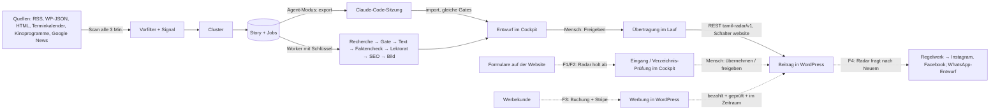

# Software-Spezifikation tamil.de

Stand: 13.11.2026 · Geltung: nur tamil.de (Gesamtvertrag Anlage 1, Teil A und B) · Maßstab für „fertig“ bleibt
`docs/vertrag/leistungen.md`. Diese Spezifikation sagt, **wie** die Software jeden Vertragspunkt erfüllt: Systeme,
Rollen, Kanäle, jedes Objekt mit allen Feldern, jede Agenten-Rolle und jeder automatische Ablauf.

| Datei | Inhalt |
|---|---|
| `README.md` | Überblick, Datenfluss, Rollen und Rechte, Kanäle, Vertrags-Matrix, Lücken |
| `datenmodell.md` | jedes Objekt mit allen Feldern, Status-Maschinen, Löschfristen |
| `agenten.md` | jede Agenten-Rolle: Zweck, Ein- und Ausgabe, Modell, Prompt, Regeln, Kosten, Fehler, Protokoll |
| `automationen.md` | jeder automatische Ablauf: Auslöser, Regel, Stopp-Schalter, Protokoll, Wiederholung; Zeitplan |

**Quellen der Wahrheit:** Code im Repo (Stand dieses Datums) für alles Gebaute; die Festlegungen F0–F4
(`docs/vertrag/festlegung-*.md`) für alles noch nicht Gebaute. Alle fünf Festlegungen sind **Vorschläge vom
11.11.2026**; ein Ja von Luis liegt für keine vor (es gibt noch keine Datei `docs/abnahme/*-F*.md`). Was hier als
„spezifiziert“ steht, ist deshalb die Fassung der Festlegung und kann sich mit dem Ja noch ändern. Unsicheres ist als
**zu prüfen** markiert, nicht geraten. Werte von Geheimnissen stehen nirgends, nur Variablen*namen*.

**Stand-Begriffe** (in allen vier Dateien gleich):

| Stand | Bedeutung |
|---|---|
| live | gebaut und in Betrieb (Radar: `tamil.hk-growthoperator.de`; Website: Testsystem `tamil-web…sslip.io`, bis Tor B3) |
| gebaut, aus | Code vorhanden, aber per Funktionsschalter, Variable oder fehlendem Schlüssel ausgeschaltet |
| in Bau | Arbeit begonnen, im Repo noch nicht vollständig |
| spezifiziert | in einer Festlegung beschrieben, kein Code |
| offen beim Auftraggeber | wartet auf Zuarbeit von KBS oder ein Tor bei Luis (`docs/vertrag/zuarbeit-kbs.md`) |

## Was die Software ist

tamil.de ist ein WordPress-Magazin für die tamilische Community in Deutschland, Österreich und der Schweiz, hinter dem
eine Agenten-Software (News-Radar mit Redaktions-Cockpit) Quellen beobachtet, Beiträge mit überprüfbaren Belegen
vorbereitet und erst nach menschlicher Freigabe veröffentlicht; dazu kommen Einsendungen, ein Verzeichnis, eine
Werbebuchung und Social-Kanäle, die nur nach freigegebenen Regeln automatisch laufen.

## Systeme

| System | Aufgabe | Technik | Code | Betrieb | Daten |
|---|---|---|---|---|---|
| Website | Öffentliches: Beiträge, Rubriken, Kalender, Kontakt, später Formulare, Verzeichnis, Werbebuchung | WordPress 6 mit SQLite, Theme `tamil`, Plugins `tamil-site` (Website-Funktionen) und `tamil-radar` (Schnittstelle zum Radar) | `wordpress/` | Coolify-App „tamil-web“ | Volumes `wp-content/database`, `wp-content/uploads` |
| News-Radar | Quellen abrufen, Storys bilden, Belege sammeln, Entwürfe vorbereiten, Freigegebenes übertragen | Python 3, SQLite (WAL), Dienst-Prozess mit Zeitplan | `news_radar/`, `sources.toml` | Coolify-App „tamil.de“ | Volume `/app/data` (`radar.sqlite`, `bilder/`, `backup/`) |
| Cockpit | Prüfen, Bearbeiten, Freigeben, Stopp, Protokoll, Zeitplan, Kosten, Benutzer | Flask unter gunicorn, serverseitige Sitzungen, CSRF, CSP ohne Inline-Script | `news_radar/web/` | im Radar-Container, `https://tamil.hk-growthoperator.de` | Radar-Datenbank |
| Agent-Modus | Recherche und Text durch eine Claude-Code-Sitzung statt durch API-Aufrufe, mit denselben Gates | HTTPS-Endpunkte `/api/agent/*` mit Bearer-Token | `news_radar/agent_v2.py`, `web/api.py`, `.claude/agents/redakteur.md` | außerhalb des Servers | Radar-Datenbank |

Externe Dienste (nur über offizielle Zugänge, §3 Abs. 3; in Tests immer Fakes):

| Dienst | Wofür | Variable(n) | Stand |
|---|---|---|---|
| Anthropic API | Sprachmodelle der Rollen | `ANTHROPIC_API_KEY` (oder `RADAR_ANTHROPIC_API_KEY`) | offen beim Auftraggeber (Tor B1); ohne Schlüssel schreibt nur der Agent-Modus |
| Gemini (Bild-KI) | KI-Symbolbilder, Bildpool | `GEMINI_API_KEY`, `BILD_MODELL`, `BILD_GROESSE` | gebaut, aus (Schlüssel nicht gesetzt) |
| Unsplash, Pexels | Stockfotos | `UNSPLASH_ACCESS_KEY`, `PEXELS_API_KEY` | gebaut, aus |
| NewsAPI, GNews | Token-Quellen | `NEWSAPI_KEY`, `GNEWS_TOKEN` | gebaut, aus (zu prüfen) |
| Wikimedia Commons | Bild mit Nachweis | – | live |
| WordPress-REST (eigene Website) | Übertragung der Beiträge | `WP_URL`, `WP_USER`, `WP_APP_PASSWORD`, `WP_POST_STATUS` | live |
| Webhook | Digest, Hinweis auf neue Entwürfe, Budgetwarnung | `NOTIFY_WEBHOOK_URL` | gebaut; ob gesetzt: zu prüfen (steht nicht in `docs/betrieb.md`) |
| Stripe | Zahlung der Werbebuchung | Namen folgen mit dem Bau | spezifiziert (F3), Echtbetrieb offen beim Auftraggeber |
| Meta (Instagram, Facebook) | Social-Veröffentlichung | Namen folgen mit dem Bau | spezifiziert (F4), Konten offen beim Auftraggeber |

**Trennung (verbindlich, `.claude/rules/vertrag.md`):** WordPress hält Öffentliches, Kunden und Geld; das Cockpit hält
Agenten, Prüfung, Freigabe, Zeitplan, Stopp und Protokoll. Der Radar holt bei WordPress ab, WordPress ruft den Radar
nie auf. Website und Cockpit bleiben getrennt abnehmbar.

## Datenfluss

Durchgezogen = gebaut, gestrichelt = spezifiziert.

Kurz: Quellen → Scan → Story mit Jobs → Rollen (oder Agent-Modus) → Entwurf mit Claims und Belegen je Absatz →
Freigabe im Cockpit → `publisher.py` → Plugin `tamil-radar` (REST) → Beitrag auf der Website.

## Rollen und Rechte

### Menschen und Zugänge

| Rolle | Wer | Wo | Rechte (Kurzfassung) |
|---|---|---|---|
| Admin (`admin`) | Luis; bei KBS nach Zuarbeit Nr. 11 | Cockpit | alles: Benutzer, Schalter einschließlich „alles“ wieder einschalten, „Erneut“ bei toten Jobs, Export |
| Redaktion (`redaktion`) | Redaktion von KBS (Personen offen, Zuarbeit Nr. 11) | Cockpit | bearbeiten, freigeben, veröffentlichen, Storys verwerfen, Quellen ergänzen, Dossier, jeden Kanal anhalten, einzelnen Kanal wieder einschalten; künftig Eingang und Verzeichnis prüfen |
| Leser (`leser`) | Beobachter, z. B. Geschäftsführung KBS | Cockpit | alles ansehen, nichts ändern |
| KBS (Auftraggeber) | KBS, immer über Luis | Website-Verwaltung, Abnahmen | verantwortet Inhalte, Einwilligungs- und Rechtstexte (§8 Abs. 3), liefert Zuarbeit, gibt das Social-Regelwerk einmalig frei (§8 Abs. 1), prüft Werbemittel (F3), nimmt ab (§9) |
| Website-Besucher | öffentlich | Website | lesen, suchen; künftig einsenden (F1), Verzeichnis-Einträge vorschlagen (F2), Werbung buchen (F3) |
| Werbekunde | öffentlich, ohne Konto | Website | buchen, bezahlen, eigene Buchung über geheimen Link ansehen (F3) |
| Agent-Sitzung | Claude-Code-Sitzung (`redakteur`) | `/api/agent/*` mit `RADAR_AGENT_TOKEN` | Storys exportieren, Ergebnisse importieren, Nachtrag vorschlagen, Bild mit Nachweis vorschlagen; nie freigeben |
| Lesezugang | Werkzeuge (`tools/radar_bericht.py`) | `/api/bericht` mit `RADAR_LESE_TOKEN` oder `RADAR_AGENT_TOKEN` | Stand lesen |
| Radar-Nutzer `ki-agent` | der Radar | WordPress-REST mit Anwendungspasswort | WordPress-Rolle `radar` (siehe unten) |

### Rechte-Karte im Cockpit (`news_radar/web/rechte.py`, Stand: Vorschlag F0, live)

Lesen dürfen alle Angemeldeten. Jede ändernde Route trägt `@recht_noetig(...)`; ohne Recht antwortet der Server mit
403. Der Notzugang aus `WEB_USER`/`WEB_PASSWORD` ist `admin`.

| Recht | admin | redaktion | leser | Routen |
|---|---|---|---|---|
| `bearbeiten` (speichern, neu schreiben, Bild, zurücksetzen, zurückstellen, ablehnen) | ja | ja | – | `POST /entwurf/<id>`, `…/status`, `…/neu-schreiben`, `…/zuruecksetzen`, `…/bild` |
| `freigeben` (auch „erneut“ nach WordPress-Fehler, Sammelfreigabe) | ja | ja | – | `POST /entwurf/<id>/status`, `/entwurf/sammelfreigabe` |
| `veroeffentlichen` (Direkt posten, WordPress-Entwurf) | ja | ja | – | `POST /entwurf/<id>/veroeffentlichen`, `…/wp-entwurf` |
| `story_verwerfen` | ja | ja | – | `POST /story/<id>/verwerfen` |
| `quelle_ergaenzen` | ja | ja | – | `POST /story/<id>/quelle` |
| `dossier` | ja | ja | – | `POST /entwurf/<id>/dossier` |
| `anhalten` (jeden Kanal, auch „alles“) | ja | ja | – | `POST /schalter/<kanal>/an` |
| `kanal_einschalten` (einzelner Kanal) | ja | ja | – | `POST /schalter/<kanal>/aus` |
| `alles_einschalten` | ja | – | – | `POST /schalter/alles/aus` |
| `job_erneut` | ja | – | – | `POST /job/<id>/erneut` |
| `benutzer` | ja | – | – | `GET/POST /nutzer` |
| `export` (Protokoll, Kosten als Datei) | ja | – | – | `/protokoll/aktionen.jsonl`, `/protokoll.jsonl`, `/kosten.csv` |
| `abmelden` | ja | ja | ja | `POST /logout` |
| *spezifiziert F1:* `eingang_pruefen` (übernehmen, erledigt, ablehnen, Spam) | ja | ja | – | Eingang |
| *spezifiziert F2:* `verzeichnis_pruefen` (freigeben, ablehnen, feldweise annehmen) | ja | ja | – | Verzeichnis-Prüfung |
| *spezifiziert F4:* `social_entscheiden` (Beitrag unter „von Hand entscheiden“ freigeben oder verwerfen; WhatsApp „gepostet“) | ja | ja (zu prüfen: F4 nennt die Rolle nicht) | – | Social-Historie |
| *spezifiziert F4:* `regelwerk` (Regelwerk ändern, neue Fassung) | ja | – | – | Regelwerk |

Offene Frage aus F0 an Luis: Rollen wie oben, oder soll `redaktion` nicht anhalten dürfen (Vorschlag: wie oben).

### Rollen in WordPress

| Rolle | Rechte | Wer |
|---|---|---|
| `administrator` | alles; Einstellungen „Tamil.de Website“ (Funktionsschalter, Werbeplätze, Zustimmungstexte, Weiterleitungen, SEO); künftig Premium im Verzeichnis (F2) und Menü „Werbung“ (F3) | `WP_ADMIN_USER` (Luis); KBS nach Übergabe |
| Redakteur/Autor (WordPress-Standard) | Beiträge, Seiten, Mediathek, Eingabemaske „Vorspann und Termin“ | Redaktion von KBS (zu vergeben) |
| `radar` (Plugin `tamil-radar`) | `read`, `edit_posts`, `publish_posts`, `edit_published_posts`, `delete_posts`, `upload_files` | Nutzer `ki-agent` (Anwendungspasswort `RADAR_APP_PASSWORD` = `WP_APP_PASSWORD` im Radar) |

## Kanäle

| Kanal | Richtung | Was automatisch geschieht | Was ein Mensch tut | Stopp-Schalter | Stand |
|---|---|---|---|---|---|
| Website (Beiträge) | Radar → WordPress-REST | Übertragen freigegebener Entwürfe im Lauf alle 3 Min. | Freigeben oder „Direkt posten“ | `website` | live |
| Cockpit | intern | Banner bei Stopp, Zeitplan, Kosten | alles Redaktionelle | – | live |
| Instagram | Radar → Meta (offizielle Schnittstelle) | nach Regelwerk und 10 Min. Karenz veröffentlichen | Grenzfälle entscheiden, Regelwerk ändern | `instagram` | spezifiziert (F4), in Bau laut Auftrag; Konten offen beim Auftraggeber |
| Facebook | Radar → Meta | derselbe Inhalt nach Instagram, ohne zweite Freigabe | wie Instagram | `facebook` | spezifiziert (F4) |
| WhatsApp-Kanal | Entwurf im Cockpit | Text, Link und Bild vorbereiten | kopieren, im Kanal posten, „gepostet“ markieren | `whatsapp` | spezifiziert (F4) |
| Einsendungen | Website-Formulare → Radar holt ab → Eingang | abholen, Spam abwehren, prüfen, Dubletten, Zusammenfassung, Entwurf | übernehmen, erledigt, ablehnen, Spam; jede Antwort von Hand | `eingang` (Radar), Funktionsschalter `einreichungen` (Website) | spezifiziert (F1); heute Platzhalter |
| Verzeichnis | Website-Formular → Radar holt ab → Prüfung → Freigabe → Website | Pflichtfelder, Form, Dubletten, Kategorie-Vorschlag, Unterschied | jede Veröffentlichung, Änderung, Premium, Löschen | `verzeichnis` (Radar), Funktionsschalter `verzeichnis` | spezifiziert (F2) |
| Werbung | WordPress + Stripe | Preis, Verfügbarkeit, Reservierung, Zahlungsabgleich, Start und Ende nach Datum, Zählung, Erstattung nach Ablehnung | Werbemittel prüfen, pausieren, beenden, Preise | Funktionsschalter `werbung`; ein Radar-Schalter ist nicht vorgesehen (zu prüfen) | spezifiziert (F3); sechs Plätze mit Eigenanzeigen live |
| E-Mail | – | nichts (§8 Abs. 2) | jede Antwort aus dem eigenen Mailprogramm | – | erfüllt, Test `tests/test_kein_mailversand.py` |
| Webhook | Radar → Webhook | Digest 08:00, neue Entwürfe, Budgetwarnung | – | Digest ruht bei `alles` | gebaut; Variable zu prüfen |

## Vertrags-Matrix

Jeder Punkt aus `docs/vertrag/leistungen.md` → wo er im Code steht → Stand am 13.11.2026 → wie er abgenommen wird.

### Teil A – Website, Redaktion, Werbebuchung

| Nr. | Vertrag (kurz) | Modul / Datei | Stand | Abnahmetest |
|---|---|---|---|---|
| A1.1 | Responsiver Neuaufbau (Magazin, Events, Nachrichten, Community) | `wordpress/themes/tamil/` (Vorlagen, `theme.json`, `assets/css/`), `design/` | in Bau: Website läuft im bisherigen Aussehen; neues Aussehen wartet auf Tor G3 (Probeseiten `mix-ordnung`, `mix-feed`) | `tools/shots.mjs` bei 390/820/1280 ohne seitliches Scrollen; Tore G3, G4 |
| A1.2 | CMS: Startseite, Artikel, Rubriken, Suche, Archiv | WordPress-Kern; Theme `front-page.php`, `single.php`, `category.php`, `search.php`, `index.php`, `inc/queries.php` | live | Handprüfung Testsystem |
| A1.3 | Event-Einreichung | F1: Formular „Event einreichen“ (Plugin `tamil-site`, Schalter `einreichungen`) → Eingang im Cockpit | spezifiziert; heute nur Platzhalter (Customizer-Feld `event_formular` für einen Formular-Shortcode) | T7 „Termin einreichen bis zum Kalender“, `tests/test_eingang.py` (geplant) |
| A1.4 | Veranstaltungskalender | `page-events.php`, `template-parts/event-card.php`, `tamil_site_upcoming_events()` (`tamil-site/includes/queries.php`), Event-Schema `themes/tamil/inc/schema.php` | live, teilweise: der Radar überträgt nur `event_datum`, `event_ort`, `ticket_url`; Ende, Land, Veranstalter, Preis nur von Hand | T7 |
| A1.5 | Autor- und Quellenangaben | Meta `quelle_*`, `bild_credit`; `template-parts/article/quelle.php`; Autor = WordPress-Nutzer des Aufrufs | teilweise: Quelle und Bildnachweis live; Autor ist immer `ki-agent` (fester Name), ein Autorkonzept ist nicht festgelegt | Sichtprüfung |
| A1.6 | Kontakt | F1: Formular „Kontakt“; `page-kontakt.php` | spezifiziert; Seite live, Formular fehlt | F1-Abnahme, T7 |
| A1.7 | Für KBS bearbeitbar | WordPress (Beiträge, Seiten, Menüs, Mediathek, Einstellungen „Tamil.de Website“) | live | – |
| A1.8 | Neun Themenbereiche, konsistente Navigation | acht Kategorien (`sources.toml [categories]` = WordPress-Kategorien) + Seite Kontakt; `inc/navigation.php`, `inc/rubriken.php` | teilweise: Kontakt fehlt in der Rubrikleiste | Sichtprüfung |
| A1.9 | Übernahme vorhandener Inhalte | `tools/export_site.py`, `tools/migration.py` | live: 532 Beiträge, 7 Seiten, 1445 Medien | `docs/abnahme/2026-11-11-uebernahme.md` |
| A1.10 | Basis-SEO | `tamil-site/includes/seo.php` (Titel, Beschreibung, OpenGraph, `NewsArticle`, Brotkrumen), `tamil-radar/includes/seo.php`, `themes/tamil/inc/schema.php` (Event), `tamil-site/includes/indexierung.php` | live; Testsystem gesperrt für Suchmaschinen bis `WP_ENVIRONMENT_TYPE=production` | F0: Teilen-Vorschau in WhatsApp/Facebook |
| A1.11 | Weiterleitungen | `tamil-site/includes/redirects.php`, Optionen `tamil_site_redirects(_csv)`, REST `POST tamil-site/v1/weiterleitungen` | live (25 Einträge) | Prüfliste Übernahme |
| A1.12 | Sitemap | WordPress-Kern `wp-sitemap.xml` | live (nur in `production` sichtbar) | – |
| A1.13 | Performance, Mobil | `tamil-site/includes/leistung.php` (Cache-Kopfzeilen), `wordpress/Dockerfile` (Apache), Bildgrößen, lokale Schriften | teilweise: Messung Lighthouse mobil (Ziel ≥ 80) steht aus | F0: Lighthouse auf dem Testsystem |
| A1.14 | Pflichtinformationen | `tamil-site/includes/upgrade.php` legt `impressum`, `datenschutz` als Entwurf an | offen beim Auftraggeber (Texte KBS, Zuarbeit Nr. 2) | Sichtprüfung |
| A1.15 | Cookie-Consent | `tamil-site/includes/consent.php`, `assets/consent.js`, Schalter `zustimmung`, Option `tamil_site_zustimmung` | gebaut, aus (Text KBS fehlt, Ja zu F0 fehlt) | F0: ohne Zustimmung keine fremde Adresse (Browser) |
| A2.1 | Angebots- und Preisdarstellung, Pflege im Admin | F3: Seite „Werben“, Verwaltung „Angebote“ | spezifiziert; Preise offen beim Auftraggeber | T5 |
| A2.2 | Self-Service-Buchung | F3: Buchung in fünf Schritten | spezifiziert | T5 |
| A2.3 | Reservierung gegen Doppelbuchung, Freigabeprüfung | F3: Reservierung 35 Min., Prüfung durch KBS | spezifiziert | T5 (zwei Kunden gleichzeitig), T6 |
| A2.4 | Online-Zahlung, gesicherter Abgleich, Aktivierung nur nach Zahlung | F3: Stripe (signierte Meldung + Abgleich bei Rückkehr) | spezifiziert; Echtbetrieb offen beim Auftraggeber (Stripe-Konto) | T5 |
| A2.5 | Start, Wechsel, Ablauf nach Laufzeit; Kundenübersicht | F3: Aktiv-Funktion, geheimer Kundenlink | spezifiziert | T6 |
| A2.6 | Admin: Buchungsliste, Status, Prüfung, Pausieren/Beenden, Statistik | F3: Menü „Werbung“ | spezifiziert | T5, T6 |

### Teil B – Agent, Verzeichnis, Social, Betreuung

| Nr. | Vertrag (kurz) | Modul / Datei | Stand | Abnahmetest |
|---|---|---|---|---|
| B1.1 | Cockpit: Rollen, Aufgaben- und Freigabestatus, Bearbeitung, Zeitplan, Fehleransicht, Stopp, Protokoll | `news_radar/web/` (`views.py`, `redaktion.py`, `betrieb.py`, `rechte.py`), `schalter.py`, `dienst.py`, `workflow/jobs.py` | live; Rollen-Zuordnung wartet auf das Ja zu F0 | T7: `tests/test_schalter.py`, `tests/test_rechte.py` |
| B1.2 | Erfassung und Vorbereitung eingehender Beiträge, Events, Kooperations- und Werbeanfragen | F1: Eingang | spezifiziert | T7, `tests/test_eingang.py` (geplant) |
| B1.3 | Öffentliches Verzeichnis mit Kategorien, Profilen, Standortfiltern, Premium | F2: `/verzeichnis/` | spezifiziert | T4, `tests/wp/test_verzeichnis.py` (geplant) |
| B1.4 | Verzeichnis-Agent: Dubletten, Fehlfelder, Klassifikation, Vorschläge; nichts Erfundenes | F2: Rolle „Verzeichnis“ | spezifiziert | T4, `tests/test_verzeichnis_agent.py` (geplant) |
| B2.1 | Social-Beitrag aus veröffentlichten Artikeln und Events | F4: Erkennen, Vorbereiten | in Bau (laut Auftrag; im Repo noch kein Code) | T1, T2 |
| B2.2 | Instagram nach einmalig genehmigten Regeln | F4: Regelwerk, Karenz, Veröffentlichen | in Bau; offen beim Auftraggeber (Konten, Freigabe Regelwerk) | T1 |
| B2.3 | Derselbe Inhalt auf Facebook ohne zweite Freigabe | F4 | in Bau | T1, T2 |
| B2.4 | Fehler, Dubletten, Pausen, Historie, nicht Freigabefähiges im Cockpit | F4: Social-Historie | in Bau | T1–T3 |
| B3.1 | WhatsApp-Inhalte vorbereitet, Veröffentlichung von Hand | F4: WhatsApp-Entwurf | in Bau | T3 |
| B3.2 | E-Mail vollständig manuell | kein Versand im Code; `tests/test_kein_mailversand.py` | live (erfüllt) | automatischer Test |
| B4 | Feinjustierung 4 Wochen, Betreuung 3 Monate | – | beginnt nach Livegang (Tor B3) | – |
| B5 | Sieben Abnahmetests | `/abnahme-vertrag`, `docs/abnahme/<datum>-B5.md` | offen | T1–T7 |

**Nicht als eigener Punkt im Leistungsverzeichnis, aber Kern der Agenten-Software:** die Redaktion v2 (Scan, Storys,
Belege, Rollen, Gate, Entwürfe, Agent-Modus, Nachtrag, Bild mit Nachweis). Stand: live; Scan und Übertragung laufen,
Schreiben läuft im Agent-Modus, weil der Anthropic-Schlüssel fehlt (Entscheidung Luis 12.11.2026: „Schreib-Automatik
später“). Interne Abnahme: `python -m news_radar abnahme` (62 Szenarien, Kriterien K1–K9).

### Die sieben Abnahmetests (B5)

| Nr. | Test | Baustein | automatisch | von Hand auf dem Testsystem |
|---|---|---|---|---|
| T1 | Artikel zu Instagram und Facebook | 5 (F4) | `tests/test_social.py` (geplant), Abnahme-Szenarien | Beitrag freigeben; Kennung und Link beider Kanäle in der Historie |
| T2 | Veranstaltung zu Instagram und Facebook | 5 (F4) | Szenarien „Termin in der Zukunft“, „Termin vorbei“ | Termin aus einer Einsendung veröffentlichen |
| T3 | WhatsApp-Entwurf | 5 (F4) | `tests/test_social.py` (geplant) | kopieren, posten, „gepostet“ markieren |
| T4 | Verzeichnis: Neueintrag und Änderungsfreigabe | 3 (F2) | `tests/wp/test_verzeichnis.py`, `tests/test_verzeichnis_agent.py` (geplant) | vorschlagen, freigeben, finden; Telefonnummer ändern |
| T5 | Werbebuchung mit erfolgreichem und fehlgeschlagenem Checkout | 4 (F3) | `tests/wp/test_buchung.py` (geplant) | Testkarte Erfolg und Ablehnung |
| T6 | Geprüfte Aktivierung und Laufzeitende | 4 (F3) | Aktiv-Funktion mit gestellter Uhr (geplant) | ein Tag Laufzeit |
| T7 | Agenten-Stopp, Fehlerbehandlung, redaktionelle Verwaltung | 1, 2 | `tests/test_schalter.py`, `tests/test_rechte.py` (vorhanden), `tests/test_eingang.py` (geplant) | Kanal stoppen, Beitrag freigeben: nichts geht hinaus; Fehler, „Erneut“; Termin einreichen bis Kalender |

## Lücken zwischen Vertrag und Code (Stand 13.11.2026)

| Bereich | Lücke | Bezug |
|---|---|---|
| Festlegungen | Ja zu F0–F4 am 13.11. (`docs/abnahme/2026-11-13-auftrag-luis.md`); Bau auf dem Testsystem, im Echtbetrieb Schalter aus | alle |
| Einsendungen | Kein Formular, kein Eingang, keine Tabelle (A1.3, A1.6, B1.2) | F1 |
| Verzeichnis | Nichts gebaut (B1.3, B1.4) | F2 |
| Werbebuchung | Nur die sechs Plätze mit Eigenanzeigen; keine Buchung, Zahlung, Aktiv-Funktion, Statistik (A2.1–A2.6) | F3 |
| Social | Im Repo kein Code; `docs/regeln-social.md` (in `leistungen.md` genannt) existiert nicht | F4 |
| Kalender | Radar überträgt `event_ende`, `event_land`, `event_veranstalter`, `event_preis` nicht (`publisher.META_FIELDS`) | A1.4 |
| Autor | Jeder Radar-Beitrag trägt den Autor `ki-agent`; kein Autorkonzept | A1.5 |
| Story-Verweis | Fehler: Meta `radar_story_id` wird im Plugin auf höchstens 10 begrenzt (`tamil_radar_sanitize_meta`, Typ `int`); der Python-Test prüft nur die gesendete Nutzlast | A1.5, B1.1 |
| Löschfristen | Keine automatische Löschung: Protokoll (F0: 12 Monate), `log`, `seen`, `agent_usage` wachsen unbegrenzt | F0 |
| Sicherungen | Code hält 14 Tage (`sicherung.AUFBEWAHREN_TAGE`), F0 schlägt 30 Tage vor | F0 |
| Schalter | `eingang`, `verzeichnis`, `instagram`, `facebook`, `whatsapp` sind schaltbar, haben aber noch keinen Abnehmer | F0 |
| Kontakt in Navigation | Rubrikleiste ohne Kontakt | A1.8 |
| Performance | Lighthouse-Messung (Ziel ≥ 80) fehlt | A1.13 |
| Pflichttexte | Impressum, Datenschutz, Cookie-Text, Einwilligungstext fehlen (KBS) | A1.14, A1.15 |
| Kinoprogramme | Drei Anbieter-Schnittstellen sind laut Code „inoffiziell“ (`kino_providers.py`); Verträglichkeit mit §3 Abs. 3 zu prüfen | §3 Abs. 3 |
| Google News | Quelle widerspricht `robots.txt` (Register-Notiz), Entscheidung Luis offen | Quellen |
| Social-Bildrecht | Lizenzumfang der Bilder lautet „Online-Veröffentlichung auf tamil.de“; ein Feld „darf in sozialen Netzen“ fehlt, ohne das F4 nur Bildkarten nutzen kann | F4 |
