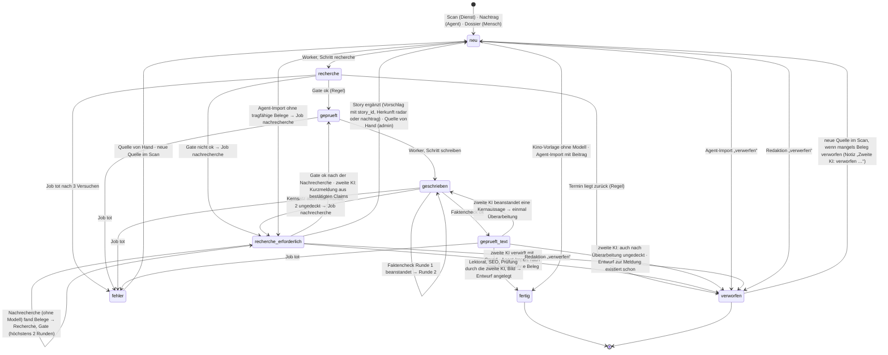
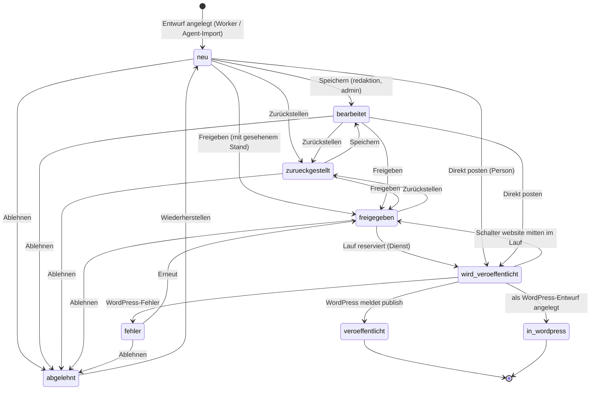
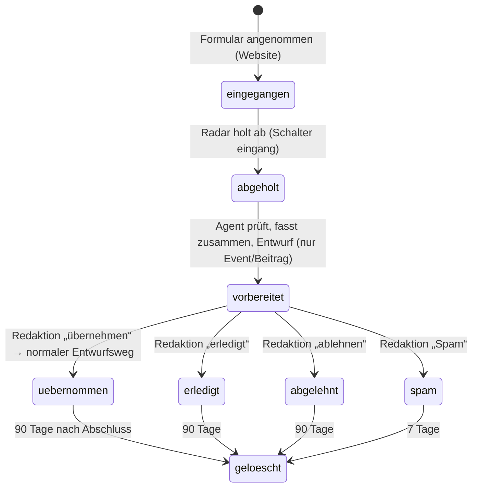
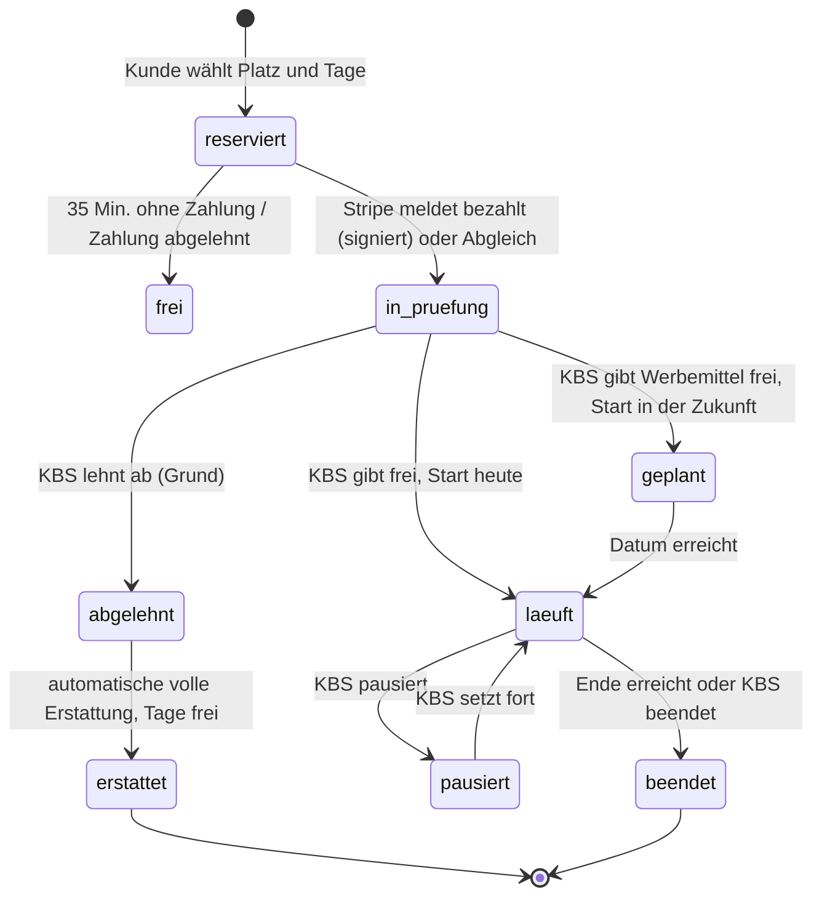
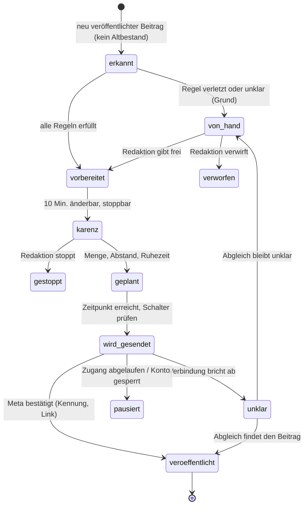
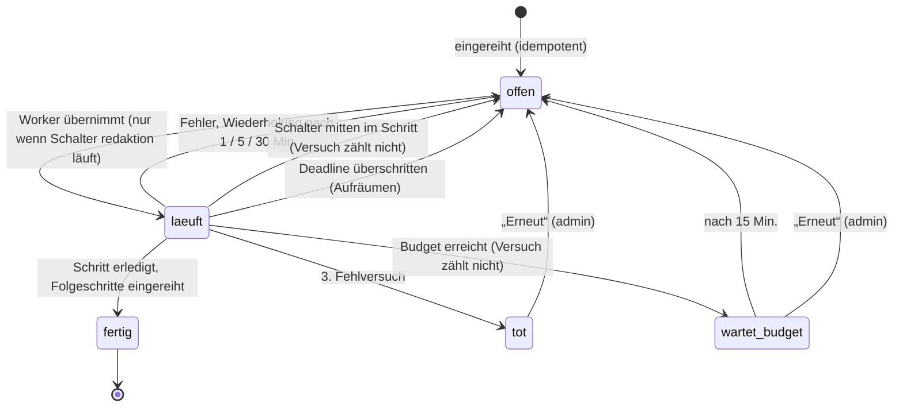

# Datenmodell

Jedes Objekt der Software mit allen Feldern. Gebautes ist aus dem Code abgeschrieben (Migrationen in
`news_radar/store.py` `SCHEMA` = Version 1 und `news_radar/workflow/schema.py` Versionen 2–7, `PRAGMA user_version`;
WordPress-Felder aus `wordpress/plugins/*/includes/*.php`). Noch nicht Gebautes steht als **spezifiziert, nicht gebaut**
mit Verweis auf die Festlegung; Feldnamen dort sind Vorschläge für den Bau.

## Speicherorte

| Ort | Inhalt | Technik | Sicherung |
|---|---|---|---|
| Radar-Datenbank `$RADAR_DATA_DIR/radar.sqlite` (Container `/app/data`) | alle Radar- und Cockpit-Objekte | SQLite, WAL, `busy_timeout` 5 s, Migration beim Start (eine Schreibtransaktion je Version) | täglich 03:00 nach `/app/data/backup`, 14 Tage |
| `/app/data/bilder/` | Beitragsbilder (`<stem>.jpg`, `-thumb.jpg`) | Dateien | mit der Sicherung |
| `/app/data/archiv/` + `archiv.json` | lizenzierte eigene Bilder | Dateien + JSON | mit der Sicherung (zu prüfen) |
| `/app/data/bildpool/<thema>/` | Reserve-Symbolbilder | Dateien | zu prüfen |
| `sources.toml` | Quellen-Register, Bildquellen, Kategorien, Stichwörter, Sperrlisten, Regionen | TOML im Repo | Git |
| `news_radar/prompts/*.md` | Prompts je Rolle | Markdown im Repo; Version = Hash | Git |
| WordPress-Datenbank (Volume `wp-content/database`) | Beiträge, Seiten, Meta, Optionen, Nutzer; künftig Einsendungen, Verzeichnis, Buchungen | SQLite | Coolify-Sicherung der Volumes |
| WordPress-Medien (Volume `wp-content/uploads`) | Mediathek | Dateien | Coolify-Sicherung |

**Konventionen:** Zeiten sind ISO 8601 in UTC mit Sekunden (`now_iso()`), sofern nicht anders genannt; Budget-Tag und
-Monat rechnen in Europe/Berlin. „JSON“ = Text mit JSON-Inhalt. „Pflicht“ = `NOT NULL` oder vom Code verlangt.
„Herkunft“ = wer oder was das Feld schreibt. „Ändern“ = wer es danach ändern darf. „Frist“ nur bei Personendaten.

## Personendaten im Überblick

| Objekt | Personendaten | Frist (gebaut) | Frist (F0–F3, Vorschlag) |
|---|---|---|---|
| Benutzer (`users`) | Benutzername, Passwort-Hash, letzter Login | keine; Sperren setzt `aktiv = 0` | nicht festgelegt (zu prüfen) |
| Sitzung (`sitzungen`) | Benutzername, Sitzungskennung | 30 Tage, abgelaufene werden bei jeder Anmeldung gelöscht | – |
| Protokoll (`editorial_actions`) | Benutzername in `wer` | keine | 12 Monate (F0) – nicht gebaut |
| Ereignisprotokoll (`log`) | Benutzername in `data.von` | keine | zu prüfen (F0 nennt nur „Protokoll“) |
| Entwurf (`drafts.bearbeitet_von`) | Benutzername | keine | – |
| Quelldokumente | Namen aus veröffentlichter Presse | keine | zu prüfen |
| Einsendung (F1), Kopie im Radar (`einsendungen`) | Name, E-Mail, Telefon (kein IP-Hash) | 90 Tage nach Abschluss, Spam 7 Tage; auf der Website nicht mehr vorhanden (`wp_status = fehlt`): 30 Tage nach dem Vermerk, auch wenn noch offen (`eingang loeschen`, täglich 03:30). Offene Einträge mit bekanntem Gegenstück folgen der Frist der Website. Kontaktdaten gehen nie an das Modell, Freitext wird vorher maskiert | 90 Tage nach Abschluss; Spam 7 Tage; IP-Hash 24 Stunden |
| Verzeichnis-Einsendung (F2) | Name, E-Mail des Einsenders | – | 90 Tage |
| Buchung (F3) | Firma, Ansprechperson, Rechnungsadresse, E-Mail, Telefon, USt-ID | – | steuerliche Frist, nennt KBS (offen) |
| Sicherungen | alles Obige – auch Einsendungen, die im Radar schon gelöscht sind, bleiben bis zum Ablauf der Sicherung darin | 14 Tage (`sicherung.AUFBEWAHREN_TAGE`); eine gelöschte Einsendung ist damit spätestens 14 Tage nach der Löschung überall fort | 30 Tage (F0) |

Regel für alle: Namen und Kontaktdaten stehen nie in Protokollen, Logs oder Testdaten aus dem Echtbetrieb
(`.claude/rules/vertrag.md`).

---

## 1. Quelle (Register)

Ort: `sources.toml`, Abschnitte `[[source]]` → `config.Source`. 43 Einträge, 10 davon `enabled = false`. Typen:
`rss` 23, `kino` 7, `html` 6, `tribe_events` 2, `gnews_region`, `wp_json`, `jsonld_events`, `newsapi`, `gnews` je 1.
Herkunft aller Felder: Entwickler per Commit (Änderung wird mit dem nächsten Deploy wirksam). Ändern: nur über das
Repo; das Cockpit zeigt das Register an (`/quellen`), ändert es nicht.

| Feld | Typ | Pflicht | Bedeutung, Werte | Prüfung |
|---|---|---|---|---|
| `name` | Text | ja | Anzeigename, Schlüssel für `source_status` | eindeutig (zu prüfen, ob erzwungen) |
| `type` | Text | ja | `rss`, `gnews_region`, `wp_json`, `html`, `kino`, `tribe_events`, `jsonld_events`, `newsapi`, `gnews` | bekannter Typ |
| `url` | Text | je Typ | Abrufadresse | Abruf nur über `net.safe_get` (SSRF-Schutz, Weiterleitungen, Größenlimit) |
| `query` | Text | nein | Suchausdruck (`gnews_region`, Token-APIs) | – |
| `language` | Text | nein | Standard `de` | – |
| `provider` | Text | bei `kino` | `cinestar`, `kinoheld`, `cineplexx` | – |
| `endpoint` | Text | nein | `wp_json`: `posts`, `mec-events` … | – |
| `params` | Objekt | nein | Typ-Parameter (z. B. `when`, `max_queries`, `per_run`, `stadt`) | – |
| `selectors` | Objekt | bei `html` | CSS-Selektoren `item`, `title`, `link`, `date`, `summary`, `sprache` | – |
| `kind` | Text | nein | `news`, `event`, `kino` (Vorgabe für alle Treffer) | – |
| `country` | Text | nein | `DE`, `AT`, `CH` oder leer | – |
| `min_score` | Zahl | nein | überschreibt die Stichwort-Schwelle; `0` = vertrauenswürdig | – |
| `bezug_noetig` | ja/nein | nein | jede Meldung braucht einen Begriff aus `[bezug]` | – |
| `kollywood` | ja/nein | nein | Nachrichten gelten für die Ausland-Regel als Kino/Entertainment | – |
| `max_items` | Zahl | nein | Treffer je Lauf, Standard 3 | – |
| `interval_minutes` | Zahl | nein | `0` = jeder Lauf | – |
| `enabled` | ja/nein | nein | `false` = abgeschaltet, bleibt im Register | – |
| `prioritaet` | Text | nein | `A` Kernquelle, `B` ergänzend, `C` nur Hinweise | – |
| `betreiber` | Text | nein | Betreiber der Quelle | – |
| `vertrag` | Text | nein | Vereinbarung mit dem Betreiber, leer = keine | – |
| `rechtlich_geprueft` | Datum | nein | `JJJJ-MM-TT` der Prüfung, leer = offen | – |
| `robots` | Text | nein | `erlaubt`, `verboten`, `unbekannt` (aus `quellen pruefen`) | – |
| `paywall` | ja/nein | nein | Bezahlschranke | – |
| `bild_nutzen` | ja/nein | nein | Pressebilder dürfen übernommen werden (nur mit dokumentierter Erlaubnis) | – |
| `notiz` | Text | nein | Begründungen, Entscheidungen | – |

Weitere Register-Abschnitte in `sources.toml`: `[categories.<slug>]` (`label`, `hints`; acht Rubriken `news`,
`community`, `entertainment`, `kino`, `events`, `kueche`, `sport`, `kultur`), `[keywords]` (Begriff → Punkte),
`[blocklist]` (`terms`, `termine`, `termine_wort`), `[bezug]` (`terms`, `fremdkino`, `kollywood`), `[regions]`
(`staedte`, `laender`, `aliases`, `ausland`, `herkunft`, `dach_hinweise`, `dach_hinweise_wort`).

### 1a. Bildquelle (Register)

`[[bildquellen]]` → `config.Bildquelle`, 28 Einträge. Für den Weg „Bild mit Nachweis“.

| Feld | Typ | Pflicht | Prüfung beim Laden |
|---|---|---|---|
| `host` | Text | ja | klein, ohne `www.`, ohne Pfad, mindestens zwei Namensteile, nicht gesperrt (soziale Netzwerke, Bildagenturen) |
| `betreiber` | Text | ja | nicht leer |
| `art` | Text | ja | `tempel`, `verein`, `veranstalter`, `festival`, `kino`, `betrieb`, `person`, `sport` |
| `nachweis` | Text | ja | nicht leer; wird als Bildnachweis gesetzt (nie aus dem Vorschlag eines Agenten) |
| `bild_hosts` | Liste | nein | eigenes CDN; kein geteilter Hoster |

### 1b. Quellen-Status (`source_status`)

Herkunft: Scan. Ändern: nur Maschine.

| Feld | Typ | Bedeutung |
|---|---|---|
| `name` | Text, Schlüssel | Name im Register |
| `last_ok` | Zeit | letzter erfolgreicher Abruf |
| `last_try` | Zeit | letzter Abruf mit Teilausfall (zählt für den Takt) |
| `last_error` | Zeit | letzter Fehler |
| `last_count` | Zahl | Treffer beim letzten Erfolg |
| `error_msg` | Text ≤ 300 | letzte Fehlermeldung |
| `paused_until` | Zeit | Pause nach Fehlern |
| `ok_count`, `err_count` | Zahl | Zähler |

`http_cache` (`url` Schlüssel, `etag`, `last_modified`, `updated_at`): bedingte Abrufe.

## 2. Meldung (Item)

Eine Meldung ist ein Treffer eines Scans (`sources.NewsItem`, nur im Speicher). Dauerhaft bleibt nur die Kennung in
`seen`.

| Feld | Typ | Bedeutung |
|---|---|---|
| `title`, `url`, `summary`, `source` | Text | aus der Quelle |
| `published` | Zeit | Sortierzeit (bei Termin-Quellen der Abruf) |
| `source_published` | Zeit oder leer | echtes Veröffentlichungsdatum laut Quelle |
| `image_url`, `language` | Text | – |
| `score`, `dach_score` | Zahl | Punkte des Vorfilters |
| `category_hint`, `kind`, `ort` | Text | Rubrik-Hinweis, `news`/`event`/`kino`, erkannter Ort |
| `facts` | Objekt | strukturierte Angaben (Termin, Kinoliste) |
| `fingerprint`, `uid_override` | Text | Kino-Fingerabdruck; feste Kennung |
| `uid` (abgeleitet) | Text | SHA-1 der normalisierten URL, sonst `uid_override` |
| `related` | Liste | Meldungen desselben Clusters |
| `quellen_gelaufen`, `quellen_aktiv` | Menge | Kino: welche Quellen in diesem Scan liefen bzw. eingeschaltet sind |

**`seen`** (gesehene Meldungen): `uid` (Schlüssel), `title`, `url`, `source`, `status` (`story`, `angereichert`,
`irrelevant`, `veraltet`, `abgelehnt_modell`, `entwurf` – Liste zu prüfen), `created_at`. Herkunft: Scan. Frist:
keine (wächst unbegrenzt, zu prüfen).

**`runs`** (Läufe): `id`, `started_at`, `finished_at`, `modus`, `gesammelt`, `relevant`, `entwuerfe`, `verworfen`,
`veroeffentlicht`, `fehler`, `notiz`. Herkunft: jeder `run`.

## 3. Story (`stories`)

Eine Story ist ein Ereignis, zu dem mehrere Meldungen gehören können; sie trägt Belege, Claims und Jobs.

| Feld | Typ | Pflicht | Herkunft | Prüfung | Ändern |
|---|---|---|---|---|---|
| `id` | Zahl | ja | Datenbank | – | – |
| `typ` | Text | ja | Scan (`news`, `event`, `kino`), Dossier (`dossier`), Nachtrag | Aufzählung | – |
| `status` | Text | ja | Orchestrator, Agent-Import, Mensch (verwerfen) | siehe Status-Maschine | Maschine; Mensch nur „verwerfen“ |
| `titel` | Text | nein | Scan, Nachtrag (Arbeitstitel) | – | Maschine |
| `kategorie` | Text | nein | Kategorie-Hinweis der Meldung | – | Maschine |
| `ort`, `region` | Text | nein | Ort der Meldung; Land aus der Signal-Rolle | – | Maschine |
| `sensibel` | 0/1 | ja | Signal-Rolle (`risiko = sensibel`) oder Gate (Wortliste Politik, Gericht, Gesundheit, Tod, Kinder) | – | Maschine |
| `schluessel` | Text | nein | Cluster: Event-/Kino-Schlüssel | – | Maschine |
| `prioritaet` | Zahl | ja | Scan: 30 Termin in den nächsten 7 Tagen, 20 Nachricht, 10 sonst, 0 Dossier | – | – |
| `laenge` | Text | nein | Gate: `kurz`, `normal`, `lang`, `event`, `event_mittel`, `event_lang`, `kino`, `kino_mittel`, `kino_lang`, `dossier` | Staffel nach Zahl bestätigter Claims | Maschine |
| `relevanz` | Zahl 1–10 | nein | Signal-Rolle oder Heuristik | – | – |
| `begruendung` | Text | nein | Signal-Rolle oder Vorfilter | – | – |
| `notiz` | Text ≤ 900 | nein | Gate-Gründe, Fehler, „verworfen von …“, „Quelle ergänzt …“ | – | Maschine, Mensch über Aktionen |
| `herkunft` | Text | ja | `radar` (Standard) oder `nachtrag` | – | – |
| `ereignis_datum` | Datum | nein | nur Nachtrag | `JJJJ-MM-TT` | – |
| `vorschlag` | JSON | nein | nur Nachtrag: Hinweise (Kernfakten, Bezug, Bildhinweis) – nie Beleg | – | Nachtrag ergänzen |
| `erstellt`, `aktualisiert` | Zeit | ja | Datenbank | – | – |

### Status-Maschine Story

Seit 13.11.2026 (Auftrag Luis) ist `recherche_erforderlich` kein Endzustand mehr, sondern ein Durchgangszustand
(im Cockpit „In Nachrecherche“), der nie länger dauert als die Jobs: jede Story endet als Entwurf (`fertig`) oder
`verworfen` mit Grund in `notiz`.

Jobs (`workflow_jobs.schritt`) neben den bisherigen: `nachrecherche` (ohne Modell, läuft auch ohne Schlüssel und an
Nachträgen; höchstens zwei je Story – gezählt werden die Jobs), `pruefung` (zweite KI nach der Nachrecherche),
`endpruefung` (zweite KI vor „neu im Cockpit“). Das Ergebnis jeder Runde steht im Protokoll (`log` Ereignis
`nachrecherche`: `runde`, `fehlend`, `anfragen`, `neu`, `wege`, `ergebnis`) und in `stories.notiz`; die Satzurteile der
zweiten KI in der Fassung `pruefung`. Keine neue Spalte, keine Migration. Storys, die (noch aus der Zeit davor) ohne
Job auf `recherche_erforderlich` stehen, stößt der Worker an (`orchestrator.nachrecherche_anstossen`).

`zurueckgestellt` steht in `repo.STORY_STATUS`, wird aber von keinem Übergang gesetzt (zu prüfen). Ein Nachtrag
(`herkunft = nachtrag`) läuft nie über einen Worker mit Modell, nur über den Agent-Modus; nur die Nachrecherche (ohne
Modell) darf an ihm laufen.

## 4. Quelldokument (`source_documents`)

Beleg einer Story. Text und Titel stammen immer aus dem selbst abgerufenen Dokument, nie aus einem Vorschlag.

| Feld | Typ | Pflicht | Herkunft | Prüfung |
|---|---|---|---|---|
| `id`, `story_id` | Zahl | ja | Datenbank / Recherche | – |
| `doc_key` | Text | ja | `Q1`, `Q2` … stabil je Story | eindeutig je Story |
| `url`, `url_norm` | Text | nein | Meldung, Recherche, Nachtrag, Redaktion | `url_norm` eindeutig je Story; Abruf über `net.safe_get` |
| `uid` | Text | nein | Kennung der Meldung | – |
| `publisher` | Text | nein | Verlag (`Redaktion` bei „Quelle ergänzen“) | – |
| `quelle` | Text | nein | Name im Register | – |
| `published_at`, `retrieved_at` | Zeit | nein | Quelle / Abruf | – |
| `language` | Text | nein | Sprache | – |
| `rights` | Text | nein | `frei`, `zitat`, `lizenz`, `unbekannt` | Aufzählung |
| `primaer` | 0/1 | ja | Primärquelle (Volltext des Berichts, Veranstalter, strukturierte Daten) | – |
| `art` | Text | ja | `volltext`, `zusammenfassung`, `hinweis` (nur Titel, z. B. Google News), `daten` (JSON-LD/strukturierte Werte), `redaktion` | Aufzählung |
| `titel`, `text` | Text | nein | abgerufene Seite | HTML bis 3 MB, PDF bis 8 MB / 40 Seiten (Nachtrag) |
| `text_sha256` | Text | nein | Hash des Texts | – |
| `auszug` | Text | nein | kurzer Auszug | – |

Ändern: nur Maschine. Frist: keine.

## 5. Claim (`claims`)

Eine überprüfbare Aussage mit Quellenangabe. Den Belegstatus `support` setzt das Gate nach Regeln, nie das Modell.

| Feld | Typ | Pflicht | Herkunft | Prüfung |
|---|---|---|---|---|
| `id`, `story_id` | Zahl | ja | – | – |
| `claim_key` | Text | ja | Recherche-Rolle oder Agent: `C1`, `C2` … | eindeutig je Story; doppelte IDs werden verworfen |
| `aussage` | Text | ja | Rolle | Deutsch, ohne Wertung |
| `art` | Text | nein | `was`, `wer`, `wann`, `wo`, `zahl`, `preis`, `ticket`, `zitat`, `hintergrund`, `sonstiges` | Aufzählung |
| `kern` | 0/1 | ja | Rolle | Kernaussagen: was/wer/wann/wo; bei Events Datum, Ort, Preis, Ticket |
| `quellen` | JSON-Liste | ja | Rolle | nur vorhandene `doc_key`; ohne gültige Quelle wird der Claim verworfen (`validate_refs`) |
| `support` | Text | ja | **Gate** | `bestaetigt` (Primärquelle oder zwei verschiedene Verlage), `einzelquelle`, `unbestaetigt` (nur Hinweise), `widerspruch`, `offen` |
| `confidence` | Zahl 0–1 | nein | Rolle (`sicherheit`) | auf 0–1 begrenzt |
| `fundstelle` | Text ≤ 200 | nein | Rolle | muss im Dokument stehen (`fundstelle_belegt`), sonst bestätigt sie nichts |
| `erstellt` | Zeit | nein | – | – |

## 6. Entwurf (`drafts`)

Der Beitrag, wie er im Cockpit geprüft und freigegeben wird. Spalten aus Version 1 plus `story_id` (V2), `herkunft`,
`ereignis_datum` (V5), `stand` (V6).

| Feld | Typ | Pflicht | Herkunft | Prüfung | Ändern im Cockpit |
|---|---|---|---|---|---|
| `id` | Zahl | ja | Datenbank | – | – |
| `uid` | Text | ja, eindeutig | URL der Primärquelle, `story:<id>`, `dossier:<id>` | eindeutig | nein |
| `typ` | Text | ja | `artikel`, `event`, `kino_termine` | Aufzählung | nein |
| `status` | Text | ja | Status-Maschine (unten) | nur erlaubte Übergänge | über Aktionen |
| `quelle_name`, `quelle_url`, `quelle_datum`, `quelle_sprache` | Text | nein | Primärdokument | URL nur http/https (`safe_url`) | nein |
| `weitere_quellen` | JSON-Liste `{name, url}` | nein | übrige Dokumente | URLs über `safe_url` | nein |
| `quelle_bild` | Text | nein | Bildadresse der Meldung | `safe_url` | nein |
| `relevanz` | Zahl | nein | Story / Rolle (Standard 6) | – | nein |
| `begruendung` | Text | nein | Story / Rolle | – | nein |
| `dach_bezug` | 0/1 | ja | Rolle oder Ort der Story | – | nein |
| `ort` | Text | nein | Rolle / Story | – | nein |
| `kategorie` | Text | nein | Rolle | muss eine der acht Rubriken sein, sonst bleibt die alte | ja |
| `titel` | Text | nein | Text-Rolle (≤ 90 Zeichen) | – | ja |
| `teaser` | Text | nein | Text-Rolle (≤ 220 Zeichen) | – | ja |
| `inhalt_html` | HTML | nein | Text-Rolle | `render.sanitize_html` (nh3-Allowlist); Links nur auf Quellen der Story | ja (bereinigt) |
| `schlagworte` | JSON-Liste | nein | Text-Rolle (3–6) | – | ja |
| `seo_titel` | Text | nein | SEO (≤ 60) | Regeln kürzen | ja |
| `meta_beschreibung` | Text | nein | SEO (120–155) | Regeln kürzen | ja |
| `bild_datei` | Text | nein | Medien-Rolle, Bild mit Nachweis, Cockpit-Upload | Dateiname `^[A-Za-z0-9._-]+\.jpg$` | über „Bild“ |
| `bild_credit` | Text | nein | Bildkette (Nachweis) | – | über „Bild“ |
| `bild_alt` | Text | nein | Text/SEO (≤ 125) | – | ja |
| `bild_suchbegriff`, `bild_thema`, `bild_prompt` | Text | nein | Text-Rolle | – | nein |
| `bild_origin` | Text | nein | Bildkette: `archiv`, `quelle`, `stock`/`unsplash`/`pexels`, `pool`, `ki`, `karte`, `commons`, `upload` (zu prüfen: genaue Werte je Weg) | – | über „Bild“ |
| `event_datum` | Text | nein | Text-Rolle | `JJJJ-MM-TT` (bzw. mit Uhrzeit) | ja |
| `event_ort` | Text | nein | Text-Rolle | – | ja |
| `ticket_url` | Text | nein | Text-Rolle, nur wenn in der Quelle | `safe_url` | ja |
| `fakten_json` | JSON | nein | Kino-Liste, Termindaten | – | nein |
| `fingerprint` | Text | nein | Kino-Fingerabdruck | – | nein |
| `hinweise` | JSON-Liste | nein | Gate, Faktencheck, Lektorat, SEO, Agent-Modus | – | nein |
| `original_json` | JSON | ja | Fassung bei Anlage | – | nein |
| `rewrite_count` | Zahl | ja | „Neu schreiben“ | – | – |
| `wp_post_id`, `wp_link` | Zahl/Text | nein | Übertragung | – | nein |
| `fehler` | Text ≤ 500 | nein | Übertragung | – | nein |
| `bearbeitet_von` | Text | nein | letzter Bearbeiter (Person, `radar`, `agent`) | – | automatisch |
| `freigegeben_at`, `veroeffentlicht_at` | Zeit | nein | Freigabe / Übertragung | – | automatisch |
| `story_id` | Zahl | nein | Story (fehlt bei Entwürfen aus v1) | – | nein |
| `herkunft` | Text | ja | `radar` oder `nachtrag` | – | nein |
| `ereignis_datum` | Datum | nein | nur Nachtrag; wird WordPress-Datum (12:00) | – | nein |
| `stand` | Zahl | ja | Trigger `drafts_stand`: +1 bei jeder Änderung an Inhaltsfeldern | Freigabe nur mit dem gesehenen Stand | automatisch |
| `created_at`, `updated_at` | Zeit | ja | Datenbank | – | – |

Im Cockpit änderbare Felder (`EDITABLE`): `titel`, `teaser`, `kategorie`, `inhalt_html`, `seo_titel`,
`meta_beschreibung`, `bild_alt`, `event_datum`, `event_ort`, `ticket_url`; dazu `schlagworte`. Jede Speicherung erhöht
`stand` und schreibt die Protokollzeile `gespeichert` mit Hash der Fassung. Eine neue Radar-Fassung überschreibt nie
einen von Menschen bearbeiteten Entwurf; sie landet nur in den Fassungen mit Hinweis.

### Status-Maschine Entwurf

| Aktion | von | nach | wer | Recht |
|---|---|---|---|---|
| `bearbeiten` | neu, bearbeitet, zurueckgestellt | bearbeitet | Person | `bearbeiten` |
| `freigeben` | neu, bearbeitet, zurueckgestellt, fehler | freigegeben | Person, nur mit gesehenem `stand` | `freigeben` |
| `zurueckstellen` | neu, bearbeitet, freigegeben | zurueckgestellt | Person | `bearbeiten` |
| `ablehnen` | neu, bearbeitet, zurueckgestellt, freigegeben, fehler | abgelehnt | Person | `bearbeiten` |
| `wiederherstellen` | abgelehnt | neu | Person | `bearbeiten` |
| `erneut` | fehler | freigegeben | Person, mit `stand` | `freigeben` |
| Direkt posten | neu, bearbeitet, zurueckgestellt, freigegeben, fehler | wird_veroeffentlicht | Person (Freigabe implizit) | `veroeffentlichen` |
| Lauf reserviert | freigegeben | wird_veroeffentlicht | Dienst, nur wenn Schalter `website` läuft | – |
| Ergebnis | wird_veroeffentlicht | veroeffentlicht / in_wordpress / fehler | Dienst | – |

Mit `WP_POST_STATUS=publish` (gesetzt) erscheint ein freigegebener Entwurf beim nächsten Lauf öffentlich. Sensible
Themen tragen den Hinweis „vor der Freigabe eine zweite Person lesen lassen“; eine zweite Freigabe erzwingt der Code
nicht (zu prüfen, ob gewünscht).

## 7. Artikelfassung (`article_versions`)

Jede Zwischenfassung einer Story, nur angehängt, nie geändert.

| Feld | Typ | Herkunft |
|---|---|---|
| `id` | Zahl | Datenbank |
| `story_id`, `draft_id` | Zahl | Rolle / Anlage |
| `rolle` | Text | `vorlage` (Kino), `text`, `ueberarbeitung`, `faktencheck` (mit Satzurteilen), `lektorat`, `seo`, `entwurf` (genau der Inhalt der Warteschlange), `entwurf_neu` (nicht übernommene Radar-Fassung) |
| `von` | Text | Modellname, `radar`, `kino-vorlage`, Agent-Name |
| `hash` | Text | Hash über `titel`, `teaser`, `inhalt_html`, `seo_titel`, `meta_beschreibung`, `schlagworte`, `bild_datei`, `bild_alt`, `event_datum`, `event_ort`, `ticket_url`, `kategorie` |
| `inhalt` | JSON | alle Felder der Fassung |
| `erstellt` | Zeit | Datenbank |

## 8. Bild / Asset (`assets` + Datei)

Jedes Beitragsbild hat genau einen Lizenz-Datensatz. Ohne Datensatz kein Bild (Abnahmekriterium K6).

| Feld | Typ | Pflicht | Herkunft | Bedeutung |
|---|---|---|---|---|
| `id` | Zahl | ja | Datenbank | – |
| `datei` | Text | ja | Bildkette | Dateiname unter `/app/data/bilder/` |
| `sha256` | Text | nein | Bildkette | Inhalts-Hash |
| `herkunft` | Text | ja | Bildkette | `archiv`, `quelle`, `stock`, `pool`, `ki`, `karte`, `upload`, `commons` |
| `rechteinhaber` | Text | nein | Archiv-Eintrag, Commons-API, Bildquellen-Register, Plattform | wem das Bild gehört |
| `lizenz` | Text | nein | dito | z. B. CC BY, CC BY-SA, Plattformlizenz, eigene Vereinbarung |
| `umfang` | Text | nein | dito | Nutzungsumfang, Standard „Online-Veröffentlichung auf tamil.de“ |
| `attribution` | Text | nein | dito | Bildnachweis (wird `bild_credit`) |
| `ablauf` | Datum | nein | Archiv-Eintrag | abgelaufene Archivbilder werden nicht genommen |
| `quelle_url` | Text | nein | Commons- oder Quellseite | – |
| `ki` | 0/1 | ja | Bildkette | KI-Bild: Nachweis „Symbolbild: KI-generiert · Tamil.de“ bzw. „KI-generiert – Symbolbild …“ |
| `story_id`, `draft_id` | Zahl | nein | Anlage / Bindung an den Entwurf | – |
| `erstellt` | Zeit | ja | Datenbank | – |

**Archiv-Eintrag** (`/app/data/archiv/archiv.json`): `datei`, `rechteinhaber` (Pflicht), `lizenz` (Pflicht),
`umfang`, `attribution`, `ablauf`, `themen`, `rubriken`.

**Regeln:** Pressebilder nur mit `bild_nutzen = true` im Register; Commons nur gemeinfrei/CC0, CC BY, CC BY-SA (nie
NC/ND); Bildquellen-Register nur für Seiten, die Beleg der Story sind; gesperrt sind soziale Netzwerke, Bildagenturen,
Agenturbilder, Logos, Banner (Entscheidung 11.11.2026). KI-Bilder höchstens `RADAR_KI_BILDER_JE_ARTIKEL` (1) je Story
und nur mit Budget.

**In WordPress:** Anhang aus Base64 (`tamil-radar/includes/media.php`), Beschriftung = Bildnachweis, Alt-Text, Meta
`bild_credit` und `bild_origin` am Beitrag.

**Spezifiziert, nicht gebaut:** Einsender-Bild (F1): nur JPEG/PNG ≤ 5 MB, neu gespeichert ohne Metadaten, bis zur
Übernahme nicht öffentlich, Recht vom Einsender bestätigt (Feld `bild_recht_bestaetigt`). Social-Bild (F4): 1080 × 1350
aus dem Beitragsbild, nur mit Recht zur Nutzung in sozialen Netzen, sonst Bildkarte „Grafik: Tamil.de“. Dafür fehlt im
Datensatz ein Feld wie `social_erlaubt` (ja/nein) – Vorschlag, zu prüfen mit F4.

## 9. Beitrag in WordPress (Post + Meta)

Der Radar schreibt über das Plugin `tamil-radar` (Namensraum `tamil-radar/v1`), WordPress-Rolle `radar`.

### REST-Schnittstelle

| Route | Methode | Recht | Zweck |
|---|---|---|---|
| `/tamil-radar/v1/status` | GET | lesen | Plugin-/WordPress-Version, SEO-Plugin, Kategorien, letzter Radar-Beitrag |
| `/tamil-radar/v1/beitrag` | POST | `edit_posts` + `upload_files` (`publish_posts` für `publish`/`future`) | Beitrag anlegen; gleiche `radar_uid` → 409 mit `duplikat` |
| `/tamil-radar/v1/beitrag/{uid}` | GET / PUT | lesen / schreiben | Beitrag lesen; Kinoliste u. a. aktualisieren |
| `/tamil-radar/v1/stil?n=1…20` | GET | lesen | veröffentlichte Beiträge als Stilbeispiele |
| `/tamil-site/v1/weiterleitungen` | POST | `manage_options` | Weiterleitungen als CSV setzen |

### Beitragsfelder (aus `plugin_payload`)

| WordPress | Radar-Feld | Hinweis |
|---|---|---|
| `post_title` | `titel` | `sanitize_text_field` |
| `post_content` | `render_content(row)` | Text, Quellenzeile, bei Kino die Kinoliste; bei Nachtrag der Vermerk am Ende |
| `post_excerpt` | `teaser` | – |
| `post_status` | `WP_POST_STATUS` (`publish`) | `publish`, `pending`, `draft`, `future` |
| `post_name` | Slug aus dem Titel | – |
| `post_date` | nur Nachtrag: `ereignis_datum 12:00:00` | – |
| `post_author` | aufrufender Nutzer (`ki-agent`) | Lücke A1.5 |
| Kategorien | `kategorie` (+ `kategorien`) | unbekannt → `news` bzw. Standardkategorie |
| Schlagwörter | `schlagworte` | – |
| Beitragsbild | `bild` (Base64, Dateiname, Alt, Nachweis) | – |

### Beitrags-Meta

| Schlüssel | Typ | Schreibt | Liest | Prüfung |
|---|---|---|---|---|
| `radar_uid` | Text | Radar | Plugin (Dublettenprüfung) | Text |
| `radar_story_id` | Zahl | Radar | Cockpit-Verweis | Typ `id`, ganze Zahl ohne Obergrenze (bis 13.11. fälschlich auf 10 begrenzt; ältere Beiträge zu Storys über 10 tragen noch 10) |
| `radar_relevanz` | Zahl 0–10 | Radar | – | 0–10 |
| `quelle_name`, `quelle_sprache` | Text | Radar | Theme (Quellenzeile) | Text |
| `quelle_url` | URL | Radar | Theme | `esc_url_raw` |
| `quelle_datum` | Datum/Zeit | Radar | Theme | Formate `Y-m-d H:i`, ISO, `Y-m-d` |
| `bild_credit`, `bild_origin` | Text | Radar | Theme (Bildnachweis) | Text |
| `ort` | Text | Radar, Eingabemaske | Theme | Text |
| `standfirst` | Text (mehrzeilig) | Eingabemaske | Theme, SEO | Text |
| `event_datum`, `event_ende` | Datum/Zeit | Radar (nur `event_datum`), Eingabemaske | Kalender, Event-Schema | Datumsformate |
| `event_ort` | Text | Radar, Eingabemaske | Kalender, Schema (`streetAddress`) | Text |
| `event_land` | `DE`, `AT`, `CH`, `DACH` | Eingabemaske | Kalender | Aufzählung |
| `event_veranstalter`, `event_preis`, `ticket_label` | Text | Eingabemaske | Termin-Kasten, Schema | Text |
| `ticket_url` | URL | Radar, Eingabemaske | Termin-Kasten | `esc_url_raw` |
| `kino_fakten` | JSON | Radar | Kinoliste | gültiges JSON |
| `rezept` | JSON | niemand (nur registriert; der Radar sendet es nicht) | zu prüfen (das Band „Rezept der Woche“ wählt den Beitrag über die Customizer-Option `rezept_id`) | gültiges JSON |
| `_tamil_seo_title`, `_tamil_seo_description`, `_tamil_seo_focus` | Text | Radar (`seo`) | `tamil-site/includes/seo.php` | Text; Fokus = erstes Schlagwort (das Fokus-Keyword der SEO-Rolle wird nicht übertragen) |

Schreibrecht auf Meta: `edit_posts` bzw. `edit_post`. Termin-Felder pflegt die Redaktion in der Eingabemaske
„Vorspann und Termin“ (`tamil-site/includes/metabox.php`); die Kinoliste wird dort nur angezeigt.

### Optionen der Website

| Option | Inhalt | Ändern |
|---|---|---|
| `tamil_site_funktionen` | Funktionsschalter `einreichungen`, `verzeichnis`, `werbung`, `zustimmung` (ja/nein, Standard aus) | Administrator |
| `tamil_site_settings` | Werbeplätze: `anzeigen[platz]` (HTML), `advanced_ads[platz]`, `eigen[platz]` (Eigenanzeige), `whatsapp_url` | Administrator |
| `tamil_site_zustimmung` | Texte des Cookie-Hinweises: `titel`, `text`, `notwendig`, `externe_medien`, `statistik`, `fassung` | Administrator |
| `tamil_site_seo` | SEO-Einstellungen | Administrator |
| `tamil_site_redirects`, `tamil_site_redirects_csv` | Weiterleitungen | Administrator, REST |
| `tamil_site_datenversion`, `tamil_site_upgrade_fehler` | Upgrade-Routine (Datenversion 1) | Maschine |
| `tamil_radar_settings` | `cockpit_url` | Administrator |
| `tamil_radar_version` | Plugin-Version | Maschine |

## 10. Termin

Ein Termin ist ein Beitrag mit `event_*`-Meta (kein eigener Beitragstyp). Im Radar: Story `typ = event`, Entwurf
`typ = event` mit `event_datum`, `event_ort`, `ticket_url`; Belege als Claims der Arten `wann`, `wo`, `preis`, `ticket`.
Kalender: `tamil_site_upcoming_events()` zeigt veröffentlichte Beiträge mit `event_datum` ab heute, früheste zuerst
(Liste und Monatsansicht in `page-events.php`). Event-Schema: `themes/tamil/inc/schema.php`.

| Feld | Pflicht im Kalender | Quelle heute | Quelle mit F1 |
|---|---|---|---|
| `event_datum` | ja | Radar, Eingabemaske | Einsendung „Datum und Uhrzeit“ |
| `event_ende` | nein | Eingabemaske | Einsendung „Ende“ |
| `event_ort` | ja (Gate) | Radar, Eingabemaske | „Ort mit Adresse“ + „Stadt“ (Zusammenführung zu prüfen) |
| `event_land` | nein | Eingabemaske | „Land“ (DE/AT/CH) |
| `event_veranstalter` | nein | Eingabemaske | „Veranstalter“ |
| `event_preis` | nein | Eingabemaske | „Eintritt“ |
| `ticket_url` | nein | Radar, Eingabemaske | „Ticket-Link“ |

Regeln: Ein Termin in der Vergangenheit wird kein Beitrag (`termin_vorbei`, Vorfilter `RADAR_EVENT_MAX_ALTER_TAGE`);
ein Termin braucht bestätigtes Datum und bestätigten Ort (Gate); Gedenktermine aus `[blocklist] termine` werden nie
automatisch Story.

## 11. Kino-Eintrag und Spielort

Kein eigener Beitragstyp: ein Beitrag je Film und Kinowoche, Typ `kino_termine`, mit `kino_fakten`.

| Feld | Typ | Bedeutung |
|---|---|---|
| `film` | Text | bereinigter Filmtitel |
| `woche` | Text | ISO-Kalenderwoche `JJJJ-Www` |
| `kinos[]` | Liste | Spielorte |
| `kinos[].kino` | Text | Name des Kinos |
| `kinos[].stadt` | Text | Stadt |
| `kinos[].land` | Text | `DE`, `AT`, `CH` |
| `kinos[].termine[]` | Liste Zeit | Vorstellungen `JJJJ-MM-TTTHH:MM` |
| `kinos[].von`, `kinos[].bis` | Datum | Laufzeit, wenn keine Uhrzeiten bekannt |
| `kinos[].url` | Text | Seite des Kinos |
| `kinos[].quelle` | Text | Quelle im Register (für die Vereinigung) |

Herkunft: Anbieter `cinestar`, `kinoheld`, `cineplexx` und HTML-Kinoseiten. Entwurf ohne Modell (`kino_text`).
`fingerprint` erkennt Änderungen; offene Entwürfe werden aktualisiert (`update_kino_facts`), nach der Veröffentlichung
aktualisiert der Radar bei einer Dublette die Kinoliste in WordPress (`PUT /beitrag/{uid}`). Ein Spielort bleibt nur mit
aktiver Quelle und künftigem Termin.

## 12. Einsendung (F1) – Radar-Seite gebaut (`news_radar/eingang.py`, Migration 11, Cockpit „Eingang“)

Quelle: `festlegung-einreichungen.md`. Gespeichert auf der Website (WordPress hält Öffentliches und Kunden); der Radar
holt ab und führt den Eingang. **Speicherform zu prüfen**, Vorschlag: eigene Tabelle über die Upgrade-Routine
(`tamil_site_upgrade_schritt`), nicht öffentlich; im Radar eine Tabelle `einsendungen` für Status, Hinweise und
Entwurf.

### Gemeinsame Felder

| Feld | Typ | Pflicht | Herkunft | Prüfung | Ändern | Frist |
|---|---|---|---|---|---|---|
| `vorgangsnummer` | Text | ja | Website | eindeutig, wird dem Einsender angezeigt | – | mit der Einsendung |
| `art` | Text | ja | Formular | `event`, `beitrag`, `kooperation`, `werbung`, `kontakt` | – | – |
| `eingang_at` | Zeit | ja | Website | – | – | – |
| `name` | Text | ja | Einsender | nicht leer | Redaktion | 90 Tage nach Abschluss |
| `email` | Text | ja | Einsender | Form | Redaktion | 90 Tage |
| `telefon` | Text | nein | Einsender | Form | Redaktion | 90 Tage |
| `einwilligung` | ja/nein | ja | Einsender | ohne Ja keine Annahme | – | 90 Tage |
| `einwilligung_fassung` | Text | ja | Website (Text von KBS) | – | – | 90 Tage |
| `bild` | Datei | nein | Einsender | JPEG/PNG ≤ 5 MB, neu gespeichert ohne Metadaten | – | 90 Tage, bei Übernahme in die Mediathek |
| `bild_recht_bestaetigt` | ja/nein | bei Bild | Einsender | – | – | – |
| `status` | Text | ja | Radar / Redaktion | Status-Maschine | Redaktion | – |
| `zusammenfassung` | Text | nein | Agent „Eingang“ | intern | Redaktion | – |
| `hinweise` | Liste | nein | Agent | z. B. „Datum in der Vergangenheit“, „Ort außerhalb DACH“, „mögliche Dublette“ | – | – |
| `dublette_von` | Kennung | nein | Agent | – | Redaktion | – |
| `entwurf_id` | Zahl | nein | Agent / Übernahme | Entwurf mit Vermerk „Angaben des Einsenders, ungeprüft“ | – | – |
| `notiz` | Text | nein | Redaktion | – | Redaktion | – |
| `abgeschlossen_at` | Zeit | nein | Entscheidung | Beginn der Frist | – | – |
| `ip_hash` | Text | – | Website | nicht rückrechenbar; nur für die Drossel | – | 24 Stunden |

Nicht gespeichert: das versteckte Feld (Programme), die Absendedauer (nur geprüft).

### Felder je Art

| Art | Felder (* Pflicht) |
|---|---|
| Event einreichen | Titel*, Datum und Uhrzeit*, Ende, Ort mit Adresse*, Stadt*, Land* (DE/AT/CH), Veranstalter*, Beschreibung*, Eintritt, Ticket-Link, Bild |
| Beitrag oder Thema | Thema*, Hinweis oder Text*, Link, Bild |
| Kooperation | Organisation, Anliegen* |
| Werbeanfrage | Firma, gewünschter Platz und Zeitraum, Nachricht* |
| Kontakt | Nachricht* |

### Prüfungen

Annahme auf der Website nur mit: Pflichtfeldern, Einwilligung, leerem verstecktem Feld, Absendedauer ≥ 3 s, höchstens
5 Einsendungen je Stunde und IP-Hash, höchstens 3 Links im Text. Danach markiert der Agent (entscheidet nicht): Datum
in der Vergangenheit oder unplausibel, Ort außerhalb DE/AT/CH, mögliche Dublette.

### Status-Maschine Einsendung

Ist der Schalter `eingang` an, bleiben Einsendungen unverlustig auf der Website liegen. Keine E-Mail an den Einsender;
Antworten nur von Hand (`mailto:`-Link im Cockpit).

## 13. Verzeichnis-Eintrag (F2) – spezifiziert, nicht gebaut

Quelle: `festlegung-verzeichnis.md`. Öffentlich unter `/verzeichnis/`. **Speicherform zu prüfen**, Vorschlag: eigener
Beitragstyp mit Taxonomien „Art“ und „Kategorie“ in WordPress.

### Eintrag (öffentlich)

| Feld | Typ | Pflicht | Herkunft | Prüfung | Ändern |
|---|---|---|---|---|---|
| `name` | Text | ja | Einsendung | – | nur über Freigabe |
| `art` | Text | ja | Einsendung | `business`, `dienstleister`, `verein`, `tempel` | Freigabe |
| `kategorie` | Text | nein | Agent-Vorschlag, Redaktion | Liste je Art (KBS) | Freigabe |
| `beschreibung` | Text ≤ 600 | nein | Einsendung | Länge | Freigabe |
| `adresse` | Text | nein | Einsendung | – | Freigabe |
| `plz` | Text | ja | Einsendung | Form je Land | Freigabe |
| `stadt` | Text | ja | Einsendung | nie ergänzt | Freigabe |
| `land` | Text | ja | Einsendung | `DE`, `AT`, `CH` | Freigabe |
| `bundesland_kanton` | Text | nein | Einsendung | – | Freigabe |
| `telefon`, `email`, `website` | Text | mindestens einer | Einsendung | Form | Freigabe |
| `oeffnungszeiten` | Text | nein | Einsendung | nie geraten | Freigabe |
| `bild` | Datei | nein | Einsendung | wie F1 | Freigabe |
| `premium` | ja/nein | ja | nur Administrator in WordPress | nicht über Formular oder Radar-Schnittstelle | Administrator |
| `status` | Text | ja | Freigabe | `veroeffentlicht`, `entfernt` | Redaktion |

Öffentlich wird nur, was im Formular als öffentlich gekennzeichnet ist. Schema: Geschäft, Organisation oder
Gebetsstätte. Filter (Freitext, Art, Kategorie, Land, Bundesland/Kanton, Stadt) stehen in der Adresse. Premium steht
oben und trägt sichtbar „Premium“.

### Verzeichnis-Einsendung (intern)

| Feld | Typ | Pflicht | Bedeutung | Frist |
|---|---|---|---|---|
| `typ` | Text | ja | `neu`, `aenderung`, `entfernen` | – |
| `eintrag_id` | Kennung | bei Änderung | betroffener Eintrag | – |
| `felder` | Objekt | ja | je Feld Wert und „öffentlich ja/nein“ | 90 Tage |
| `einsender_name`, `einsender_email` | Text | ja | intern, nie öffentlich | 90 Tage |
| `berechtigung` | Text | ja | `inhaber` oder `hinweis` | 90 Tage |
| `einwilligung`, `einwilligung_fassung` | ja/nein, Text | ja | – | 90 Tage |
| `pruefung` | Objekt | – | Agent: `fehlt[]`, `formfehler[]`, `dubletten[{eintrag_id, grund}]`, `kategorie_vorschlag`, `unterschied[{feld, alt, neu}]` | – |
| `entscheidung` | Objekt | – | Redaktion: je Feld angenommen/abgelehnt, Gesamtergebnis | – |
| `status` | Text | ja | `neu` → `geprueft` → `freigegeben` / `abgelehnt` | – |

Dublette: ähnlicher Name und dazu gleiche PLZ, Telefonnummer oder Website. Ohne Modell läuft die Prüfung nach festen
Regeln; nur der Kategorie-Vorschlag entfällt.

## 14. Werbeplatz und Buchung (F3)

### Werbeplatz – live

| Platz (Schlüssel) | Wo | Format Desktop / Handy | Eigenanzeige (Standard) |
|---|---|---|---|
| `leaderboard` | unter der Navigation | 728 × 90 / 320 × 50 | `production` |
| `sidebar` (Half Page) | Seitenspalte | 300 × 600 | `event` |
| `inarticle` | nach dem zweiten Absatz | 728 × 90 / 300 × 250 | `whatsapp` |
| `billboard` | Startseite zwischen Rubriken | 970 × 250 / 300 × 250 | `event` |
| `footer` | über dem Fuß | 728 × 90 / 320 × 100 | `werben` |
| `mobile` | Handy, fest unten | 320 × 50 | `whatsapp-klein` |

Reihenfolge je Platz: Advanced-Ads-Platzierung → eigenes Banner-HTML → Eigenanzeige → nichts. Fremde Inhalte werden bei
eingeschalteter Zustimmung durch die Eigenanzeige ersetzt.

### Angebot – spezifiziert, nicht gebaut

| Feld | Typ | Bedeutung |
|---|---|---|
| `platz` | Schlüssel | einer der sechs Plätze |
| `aktiv` | ja/nein | buchbar |
| `laufzeiten` | Liste Tage | Vorschlag 7, 14, 30 (offen) |
| `preis[laufzeit]` | Betrag in Cent | von KBS; Anzeige mit oder ohne USt. offen |
| `gleichzeitig` | Zahl | Vorschlag 1 (exklusiv) |
| `vorlauf_werktage` | Zahl | Vorschlag 2 |

### Buchung – spezifiziert, nicht gebaut

| Feld | Typ | Pflicht | Herkunft | Prüfung | Ändern | Frist |
|---|---|---|---|---|---|---|
| `buchungsnummer` | Text | ja | Website | eindeutig | – | steuerlich (KBS) |
| `platz`, `laufzeit`, `start`, `ende` | Schlüssel, Zahl, Datum | ja | Kunde | Tage frei (atomare Reservierung) | Administrator | steuerlich |
| `reserviert_bis` | Zeit | ja | Website | 35 Min. | – | – |
| `firma`, `ansprechperson`, `rechnungsadresse`, `email` | Text | ja | Kunde | Form | Administrator | steuerlich |
| `telefon`, `ust_id` | Text | nein | Kunde | Form | Administrator | steuerlich |
| `werbemittel_desktop`, `werbemittel_mobil` | Datei | ja | Kunde | JPEG/PNG, Maße des Platzes, Größe | – | steuerlich (zu prüfen) |
| `ziel_url` | URL | ja | Kunde | gültige http(s)-Adresse | – | – |
| `betrag`, `waehrung` | Zahl, Text | ja | Preisberechnung | aus Angebot | – | steuerlich |
| `bedingungen_fassung`, `bedingungen_at` | Text, Zeit | ja | Kunde | angenommen | – | steuerlich |
| `stripe_session`, `stripe_zahlung` | Text | ja | Stripe | nur Kennungen, keine Kartendaten | – | – |
| `zahlung` | Text | ja | Stripe-Meldung (signiert) + Abgleich | `offen`, `bezahlt`, `fehlgeschlagen`, `erstattet` | – | – |
| `pruefung` | Text | ja | KBS | `offen`, `freigegeben`, `abgelehnt` | Administrator | – |
| `ablehnungsgrund` | Text | bei Ablehnung | KBS | – | Administrator | – |
| `pausiert` | ja/nein | ja | KBS | – | Administrator | – |
| `beendet_at` | Zeit | nein | KBS (vorzeitig) | – | Administrator | – |
| `kundenlink` | Geheimnis | ja | Website | nur als Hash gespeichert (Vorschlag) | – | – |
| `protokoll[]` | Liste | ja | Maschine/Person | reserviert, bezahlt, geprüft, gestartet, beendet, von wem | – | steuerlich |

**Statistik je Buchung und Tag:** `buchung`, `tag`, `einblendungen` (mindestens halbe Fläche eine Sekunde sichtbar),
`klicks`; ohne Cookies und ohne Personendaten.

**Aktiv-Funktion (genau eine):** aktiv ⇔ `zahlung = bezahlt` ∧ `pruefung = freigegeben` ∧ `pausiert = nein` ∧
`start ≤ heute ≤ ende` (und nicht vorzeitig beendet). Alle Anzeigen fragen nur diese Funktion.

### Status-Maschine Buchung

Die angezeigten Stände (reserviert, bezahlt, in Prüfung, geplant, läuft, pausiert, beendet, abgelehnt, erstattet)
ergeben sich aus `zahlung`, `pruefung`, `pausiert` und dem Datum.

Fehler bei Zahlung oder Erstattung stehen als Warnung in der Buchungsliste und gehen an einen Menschen. Eine gefälschte
oder doppelte Zahlungsmeldung ändert nichts (Signatur, Kennung der Meldung nur einmal).

## 15. Social-Beitrag (F4) – gebaut im Trockenmodus (Migration 8, `news_radar/social/`)

Quelle: `festlegung-social.md`. Daten im Radar (Cockpit hält Agenten, Freigabe, Protokoll).

### Social-Beitrag

| Feld | Typ | Pflicht | Herkunft | Prüfung | Ändern |
|---|---|---|---|---|---|
| `id` | Zahl | ja | Radar | – | – |
| `wp_post_id` | Zahl | ja | Erkennen | veröffentlichter Beitrag oder Termin, kein Altbestand | – |
| `quelle_typ` | Text | ja | Erkennen | `beitrag`, `termin` | – |
| `kanal` | Text | ja | Radar | `instagram`, `facebook`, `whatsapp`; eindeutig mit `wp_post_id` (höchstens einmal je Kanal) | – |
| `status` | Text | ja | Status-Maschine | – | Redaktion (Entscheidungen) |
| `regel_fassung` | Text | ja | Regelwerk | Fassung, gegen die geprüft wurde | – |
| `regelpruefung` | Objekt | ja | Rolle „Social“ | je Regel erfüllt/verletzt mit Grund | – |
| `text` | Text | ja | aus Titel und Vorspann | Länge je Kanal (zu prüfen) | Redaktion während der Karenz |
| `hashtags` | Liste | nein | fest je Rubrik (KBS) | – | – |
| `link` | URL | ja | Beitragsadresse | – | – |
| `bild_datei` | Text | ja | Beitragsbild 1080 × 1350 oder Bildkarte | nur mit Social-Recht | Redaktion |
| `ki_hinweis` | ja/nein | ja | Asset `ki` | Kennzeichnung wie auf der Website | – |
| `karenz_bis` | Zeit | ja | +10 Min. | – | Redaktion (stoppen) |
| `geplant_fuer` | Zeit | nein | Menge (6/Tag), Abstand (60 Min.), Ruhezeit (22–7 Uhr) | – | – |
| `veroeffentlicht_at` | Zeit | nein | Meta-Antwort | – | – |
| `meta_id`, `meta_link` | Text | nein | Meta | – | – |
| `fehler` | Text | nein | Meta / Abgleich | – | – |
| `gepostet_von`, `gepostet_at` | Text, Zeit | nur WhatsApp | Redaktion | – | Redaktion |

### Regelwerk

| Feld | Bedeutung |
|---|---|
| `fassung` | fortlaufend; jede Änderung ist eine neue Fassung |
| `freigegeben_von`, `freigegeben_at` | einmalige Freigabe durch KBS (§8 Abs. 1), über Luis |
| `rubriken` | alle acht; „Nachrichten“ nur ohne Heikel-Markierung |
| `heikel` | Politik, Justiz, Unglück, Tod, Medizin: nie automatisch |
| `max_alter_stunden` | 48; Termine nur in der Zukunft |
| `bild` | nur mit Social-Recht, sonst Bildkarte |
| `max_je_tag`, `abstand_min` | 6, 60 |
| `ruhezeit` | 22–7 Uhr; Wartendes geht um 7 Uhr |
| `dubletten` | höchstens einmal je Kanal; Korrekturen lösen nichts aus |
| `kennzeichnung` | KI-Bilder mit Hinweis |
| `hashtags[rubrik]` | von KBS |

Ändern: nur `admin`, mit neuer Fassung und Protokollzeile. Fassung 1 steht in
`docs/regeln-social.md` und `news_radar/social/regelwerk.toml` (Freigabe durch KBS steht aus). Die Freigabe trägt
`admin` im Cockpit ein (Freigebende, Datum, Beleg im Protokoll `social_regelwerk_freigabe`); live geht nur mit
freigegebener aktueller Fassung, eine neue Fassung hat keine Freigabe. R3 gilt beim Erkennen und noch einmal
unmittelbar vor dem Senden (außer nach Freigabe von Hand).

### Status-Maschine Social-Beitrag (Instagram, Facebook)

Facebook folgt nach Instagram mit demselben Inhalt. Ist der Kanal-Schalter an, geht nichts hinaus (auch während der
Karenz); die Historie nennt den Grund. **WhatsApp:** `entwurf` → `gepostet` (Redaktion markiert, Person und Zeit im
Protokoll). Ohne Konten läuft alles im Trockenmodus bis vor den letzten Aufruf an Meta.

## 16. Stopp-Schalter (`schalter`)

| Feld | Typ | Pflicht | Herkunft | Prüfung |
|---|---|---|---|---|
| `kanal` | Text, Schlüssel | ja | Cockpit / Konsole | `alles`, `redaktion`, `website`, `eingang`, `verzeichnis`, `instagram`, `facebook`, `whatsapp` |
| `gestoppt` | 0/1 | ja | Person | – |
| `grund` | Text ≤ 300 | bei Stopp | Person | Pflicht beim Anhalten |
| `wer` | Text | ja | Person (Benutzername) | Pflicht |
| `seit` | Zeit | ja | Maschine | – |

Ein Kanal ohne Zeile läuft. „alles“ hält jeden Kanal an. Wer schalten darf: Rechte-Karte (README). Jede Änderung →
`editorial_actions` (`schalter_an`/`schalter_aus`) und `log` (`schalter`). Notweg: `python -m news_radar stopp an|aus
[kanal] --grund "…"`. Heute fragen ab: `redaktion` (Scan, Job-Übernahme, Modellaufruf, Agent-Endpunkte, Abrufe) und
`website` (Übertragung; bei Social auch der Bild-Upload vor dem ersten Aufruf an Meta), `instagram`, `facebook`
(F4: unmittelbar vor jedem Aufruf an Meta, auch während der Karenz; Facebook wartet, solange Instagram angehalten
ist) und `whatsapp` (F4: blendet die Entwürfe im Cockpit aus). `eingang` und `verzeichnis` sind schaltbar, aber
noch ohne Abnehmer.

**Nicht verwechseln:** Funktionsschalter der Website (`tamil_site_funktionen`) schalten einen Baustein auf der Website
ein oder aus (Echtbetrieb erst nach Auftragsverarbeitung und Rechtstexten); Stopp-Schalter halten automatische
Ausführungen des Radars an.

## 17. Protokoll

### Aktionen (`editorial_actions`) – das Protokoll nach §8

| Feld | Typ | Pflicht | Bedeutung |
|---|---|---|---|
| `id` | Zahl | ja | – |
| `ts` | Zeit | ja | – |
| `wer` | Text | ja | Benutzername, `dienst` oder Agent-Name |
| `aktion` | Text | ja | z. B. `freigeben`, `erneut`, `bearbeiten`, `zurueckstellen`, `ablehnen`, `wiederherstellen`, `gespeichert`, `neu_geschrieben`, `zurueckgesetzt`, `bild`, `veroeffentlicht`, `wp_entwurf`, `zurueckgehalten`, `story_verworfen`, `quelle_ergaenzt`, `dossier`, `job_erneut`, `nutzer_<aktion>`, `schalter_an`, `schalter_aus`, `nachtrag_angelegt`, `nachtrag_ergaenzt`, `geschrieben`, `verworfen` |
| `draft_id`, `story_id` | Zahl | nein | Bezug |
| `fassung_hash` | Text | nein | Hash der freigegebenen bzw. gespeicherten Fassung |
| `wp_post_id` | Zahl | nein | WordPress-Beitrag |
| `notiz` | Text ≤ 300 | nein | nur ein Grund (z. B. eines Stopps); keine Inhalte, keine Kontaktdaten |
| `gegenstand_typ`, `gegenstand_id` | Text | nein | `entwurf`, `story`, `job`, `nutzer`, `schalter` |
| `kanal` | Text | nein | Kanal der Ausführung |
| `regel_fassung` | Text | nein | Fassung der Regel (Social) |
| `ausloeser` | Text | ja | `person`, `dienst`, `agent` |

Ansicht `/protokoll` mit Filter (Person, Aktion, Kanal, Zeitraum); Export als JSONL nur `admin`. Frist: F0 schlägt
12 Monate vor – **nicht gebaut**.

### Ereignisprotokoll (`log`)

`id`, `ts`, `event`, `data` (JSON). Ereignisse u. a.: `entwurf`, `verworfen`, `recherche_erforderlich`,
`story_angereichert`, `quelle_ergaenzt`, `dossier`, `tageslimit`, `budget`, `tagesbudget`, `angehalten`, `fehler`,
`veroeffentlicht`, `in_wordpress`, `aktualisiert`, `kino_aktualisiert`, `kino_update_ignoriert`,
`entwurf_existiert`, `entwurf_nicht_ueberschrieben`, `aktion`, `bearbeitet`, `bild`, `agent`, `nachtrag`, `schalter`,
`nutzer`, `job_erneut`. Export `/protokoll.jsonl` (admin), CLI `export`. Frist: keine (zu prüfen).

## 18. Agenten-Aufruf, Kosten, Jobs

### Modellaufruf (`agent_usage`)

| Feld | Typ | Bedeutung |
|---|---|---|
| `id`, `ts` | – | – |
| `story_id`, `job_id` | Zahl | Bezug |
| `rolle` | Text | `signal`, `cluster`, `recherche`, `faktencheck`, `text`, `lektorat`, `seo`, `dossier`, `bild`, `kino`, `agent` |
| `provider` | Text | `anthropic`, `gemini`, `vorlage` (ohne Modell), `claude-code` (Agent-Modus, 0 $) |
| `modell_angefragt`, `modell` | Text | angefragt / tatsächlich (Fallback) |
| `prompt_version` | Text | erste 12 Zeichen des SHA-256 des System-Prompts |
| `input_tokens`, `output_tokens`, `cache_write_5m`, `cache_write_1h`, `cache_read`, `bilder`, `iterationen` | Zahl | Verbrauch |
| `kosten_usd`, `preis_version` | Zahl, Text | Kosten nach Preisliste `costs.PREISE` (Stand 2026-11-08) |
| `status` | Text | `ok`, `abgelehnt`, `abgeschnitten`, `ungueltig`, `fehler`, `budget` |
| `latenz_ms`, `request_id`, `fehler` | – | – |

### Budget-Reservierung (`budget_reservierungen`)

`id`, `ts`, `rolle`, `betrag`, `story_id`. Vor jedem bezahlten Aufruf wird der ungünstigste Fall reserviert;
Reservierungen verfallen nach 60 Min. Grenzen: `RADAR_BUDGET_TAG_USD`, `RADAR_BUDGET_MONAT_USD`, Warnung bei
`RADAR_BUDGET_WARNUNG` (0,8). Pilotgrenze `RADAR_ENTWUERFE_TAG` bezahlte Storys je Tag; Nachtrag eigene Grenze
`RADAR_NACHTRAG_TAG` (60).

### Job (`workflow_jobs`)

| Feld | Typ | Bedeutung |
|---|---|---|
| `id`, `story_id` | Zahl | – |
| `schritt` | Text | `recherche`, `gate`, `schreiben`, `faktencheck`, `lektorat`, `seo`, `bild`, `kino` |
| `status` | Text | `offen`, `laeuft`, `fertig`, `tot`, `wartet_budget` |
| `prio` | Zahl | 30 / 20 / 10 / 0 |
| `versuche` | Zahl | höchstens 3 |
| `naechster_versuch`, `deadline` | Zeit | Backoff; Deadline je Schritt (recherche/schreiben/faktencheck 1500 s, lektorat/seo 900 s, bild 600 s, kino 300 s, gate 120 s) |
| `idempotenz_key` | Text, eindeutig | `<story>:<schritt>[:<runde>:<job>]` |
| `payload` | JSON | Hinweise, Quelle, Runde, Anmerkung |
| `fehler`, `worker` | Text | – |
| `erstellt`, `aktualisiert` | Zeit | – |

## 19. Benutzer und Sitzung

### Benutzer (`users`)

| Feld | Typ | Pflicht | Herkunft | Prüfung | Ändern |
|---|---|---|---|---|---|
| `name` | Text, Schlüssel | ja | admin (Cockpit `/nutzer` oder CLI `nutzer anlegen`) | – | admin |
| `passwort_hash` | Text | ja | Werkzeug-Hash (`werkzeug.security`) | Passwort ≥ 10 Zeichen | admin |
| `rolle` | Text | ja | admin | `admin`, `redaktion`, `leser`; der letzte aktive Admin kann nicht herabgestuft werden | admin |
| `aktiv` | 0/1 | ja | admin | Sperren setzt 0 und beendet alle Sitzungen | admin |
| `erstellt`, `letzter_login` | Zeit | – | Maschine | – | – |

Notzugang aus der Umgebung: `WEB_USER`/`WEB_PASSWORD` (≥ 12 Zeichen, sonst startet das Cockpit nicht), Rolle `admin`.
Anmeldung gedrosselt: 10 Fehlversuche je IP bzw. 20 je Benutzer in 15 Min.

### Sitzung (`sitzungen`)

`id` (zufällige Kennung, Schlüssel), `nutzer`, `konto` (`db` oder `env`), `erstellt`, `ablauf` (30 Tage). Serverseitig:
Sperren, Rollenwechsel und Abmelden wirken sofort, auch auf kopierte Cookies. Cookie `HttpOnly`, `Secure` bei HTTPS,
`SameSite=Lax` (eingebettet `None`). CSRF-Token je Sitzung.

## 20. Dienst-Lauf (`dienst_laeufe`)

| Feld | Typ | Bedeutung |
|---|---|---|
| `id` | Zahl | – |
| `aufgabe` | Text | `scan`, `digest`, `sicherung`, `bildpool` |
| `start`, `ende` | Zeit | – |
| `ergebnis` | Text | `ok`, `fehler (Code n)`, `timeout`, `abgebrochen`, `angehalten (<kanal>)` |

Ansicht `/zeitplan`: Takt, letzter Lauf, nächster Lauf, Ergebnis.
